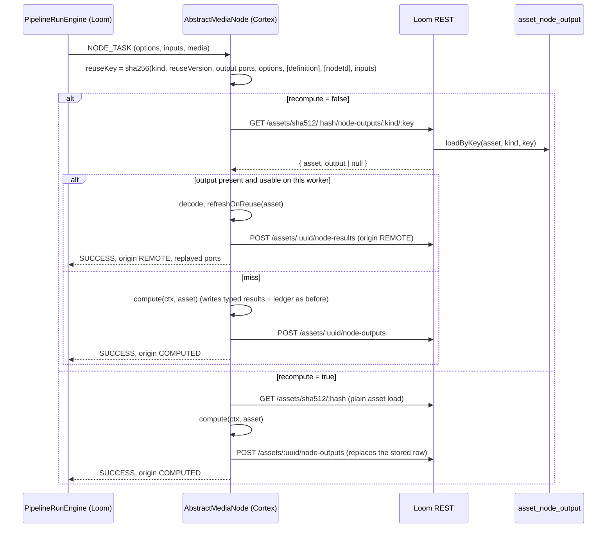

# Node Output Reuse

> A node that has already answered the same question for an asset replays its stored answer instead
> of computing it again. "The same question" is the same node kind, the same options and the same
> input values. The answer is the port values the node emitted. A pipeline that has seen an asset
> before therefore runs in the time it takes to look the answer up.

**Scope.** This file owns the reuse mechanism end to end: the reuse key, the `asset_node_output`
table, the `node-outputs` REST routes, `ReusePolicy`, the `recompute` switch and the per-node policy
table. It does **not** own:

| Topic | Owner |
|---|---|
| The processing ledger (`asset_node_result`, "did node X run here") | [NODES.md](NODES.md) §2 |
| The typed result tables a node writes (transcripts, detections, json comps) | [NODES.md](NODES.md) §2, [../../loom/DOMAIN.md](../../loom/DOMAIN.md) |
| The in-process caches (`LocalResultCache`, `ArtifactCache`) | [NODES.md](NODES.md) §4 |
| Ports, content types, coercion | [NODE_DATA_TYPES.md](NODE_DATA_TYPES.md) |
| How the engine dispatches tasks | [../pipeline/PIPELINE.md](../pipeline/PIPELINE.md) |

---

## 1. Why it exists

Until 2026-10-11 nothing skipped work across runs:

- `PipelineRunEngine` never read `asset_node_result`; the ledger was write-only from the pipeline's
  point of view.
- Every node's `LocalResultCache` is an instance field, and `NodeTaskRunner` builds a **new node
  instance per task** (unscoped `Provider.get()` in `RegistryNodeRegistrar`). The cache died with the
  task, so it never hit across items, runs or pipelines - whatever the field's javadoc claimed.
- A second pipeline running `whisper` on an already transcribed video transcribed it again.

The typed tables held the domain result, but not the port values a node hands downstream, so there was
nothing generic a node could replay to feed the rest of the graph.

---

## 2. How it works



**The lookup costs nothing extra.** `AbstractMediaNode` always loaded the asset by SHA-512 before
`compute`. The lookup route answers with the asset *and* the stored output, so it replaces that load.
On a miss the node has exactly what it had before; on a hit it saves the computation and the typed
writes, and records an `asset_node_result` ledger row with origin `REMOTE`. The only other new
request is the store after a real computation.

**Everything happens in `AbstractMediaNode.process()`.** All processing nodes extend it and none
overrides `process()`, so no node needed code to take part. A node only states its policy (§4) and,
where needed, which ports to refresh on a replay.

### 2.1 The reuse key

`NodeOutputReuse.reuseKey(...)` hashes a canonical JSON document (sorted keys, integral numbers as
longs) with SHA-256:

| Part | Source | Why |
|---|---|---|
| `kind` | `name()` | One store, many kinds |
| `version` | `reuseVersion()`, default `"1"` | Bump by hand when the output changes for the same input (bug fix, new algorithm) |
| `outputs` | `outputSignature(getClass())`: every static `OutputPort` as `id|contentType|cardinality` | A changed port shape invalidates without anyone remembering to bump |
| `options` | `JsonObject.mapFrom(options())` minus `enabled`, `recompute`, `timeoutMs`, `retryFailed` | Model path, thresholds, languages - everything that can change the answer |
| `definition` | the pipeline node definition, only for `PipelineConfigurable` nodes, minus structural keys | Their configuration *is* the definition |
| `nodeId` | `nodeId()`, only for `ReusePolicy.PER_NODE_ID` | Scopes reuse to one node instance |
| `inputs` | every input port: `contentType` + values; **origins excluded**; the item's own media path replaced by `$media` | The values decide the answer; which run delivered them does not |

The **asset is not in the key**: the store is keyed by `(asset_uuid, node_kind, reuse_key)` already.
The node id is not in the key by default, which is what lets a second pipeline find the first one's
output.

### 2.2 The stored form

`NodeOutputReuse.encode(...)` stores each output port as
`{contentType, cardinality, values}`, with values coerced exactly as `PortOutput.toPayload` coerces
them for the wire. Two worker-local details are normalised:

- A value equal to the item's own media path is stored as `$media` and replaced with the current
  worker's path on replay.
- On replay, any other `media/*` or `artifact/*` value that is an absolute path must exist on this
  worker; otherwise the stored output is **not used** and the node computes. Produced bytes
  (thumbnails, depth maps, TTS audio) live on the worker that made them - see
  [NODES.md](NODES.md) §2.1.

Outputs larger than `NodeOutputReuse.MAX_STORED_BYTES` (4 MiB encoded) are not stored.

### 2.3 What is stored, and when

Only a **real computation that succeeded**: `ResultState.SUCCESS` with origin `COMPUTED` (or
unreported). Not stored:

- `FAILED` - replaying a failure would turn a transient outage into a permanent answer (the DAO, the
  validator and a table `CHECK` refuse it too).
- `SKIPPED` - a skip may have a transient reason. The table allows `SKIPPED` for a future opt-in; the
  Cortex side never sends it today.
- `LOCAL` / `REMOTE` origins - already a replay of something.
- A computation whose typed write failed. Several nodes report SUCCESS to the engine and FAILED to the
  ledger when the transcript/json-comp write fails; `AbstractMediaNode` remembers the ledger state of
  the execution and does not store in that case, or the missing typed result would never be written
  again.

### 2.4 Recompute

`recompute` forces the computation and replaces the stored row (same key, so the next plain run finds
the fresh output). Two ways to set it, both read by `AbstractMediaNode.isRecompute()`:

| Where | For which nodes | How |
|---|---|---|
| Node option `recompute` (`AbstractNodeOptions`, `@ParamDoc` order 40) | Every node; shown as a switch in the pipeline editor via the harvested descriptor | Worker YAML, or the definition for `PipelineConfigurable` nodes |
| Pipeline node definition key `recompute` | Every media node, including worker-configured ones | `RegistryNodeRegistrar.adapt()` calls `AbstractMediaNode.useDefinition(nodeDef)` |

`recompute` is excluded from the key on purpose.

---

## 3. Persistence and REST

### 3.1 Table `asset_node_output` (V2.116)

| Column | Notes |
|---|---|
| `uuid` | `uuidv7()` |
| `asset_uuid` | FK `asset`, **ON DELETE CASCADE** |
| `node_kind`, `reuse_key` | with `asset_uuid`: **UNIQUE** - the lookup key and the upsert key |
| `node_id` | last writer, informational |
| `producer_version` | what the node last passed to `recordNodeResult` |
| `state` | `CHECK IN ('SUCCESS','SKIPPED')` |
| `reason` | skip reason |
| `outputs` | jsonb, `JsonObjectConverter` via the `.*\.outputs` forcedType |
| `run_uuid` | FK `pipeline_run`, **ON DELETE SET NULL** |
| `created`, `edited` | `created` survives an upsert |

Not the ledger: `asset_node_result` is one row per node instance and records that it ran;
`asset_node_output` is one row per configuration (and per element of a fanned-out sequence) and
records what came out.

### 3.2 Routes

All under `/api/v1`. Paths are plural per [../../guidelines/CODING.md](../../guidelines/CODING.md).

| Method | Path | Permission | Purpose |
|---|---|---|---|
| GET | `/assets/sha512/:sha512/node-outputs/:nodeKind/:reuseKey` | `READ_ASSET` | The lookup every node makes: `{asset, output}`; `output` null on a miss; 404 for an unknown asset |
| GET | `/assets/:uuid/node-outputs/:nodeKind/:reuseKey` | `READ_ASSET` | Same, by uuid (the path param also accepts a bare hash) |
| POST | `/assets/:uuid/node-outputs` | `UPDATE_ASSET` | Store / replace (201) |
| GET | `/assets/:uuid/node-outputs?nodeKind=` | `READ_ASSET` | List, optionally one kind |
| DELETE | `/assets/:uuid/node-outputs?nodeKind=` | `UPDATE_ASSET` | Forget, optionally one kind (204). Typed results are untouched |

A reader (`READ_ASSET` only) can look up but not store: otherwise a reader could plant an output that
every later run would replay as computed. `NodeOutputEndpointTest.testReadAssetCanLookUpButNotWrite`
pins this.

Client: `NodeOutputMethods` (`loom-client/common`), implemented by `LoomHttpClientImpl`; Python:
`clients/python/loom_client/methods/node_output.py`.

---

## 4. Reuse policy per node

`AbstractMediaNode.reusePolicy()` returns a `ReusePolicy`:

| Policy | Meaning |
|---|---|
| `SHARED` (default) | Reuse what any instance of the kind stored with the same key, in any pipeline |
| `PER_NODE_ID` | The node id is mixed into the key: only this graph-local instance's output is reused |
| `NEVER` | Always compute; no lookup, no store |

| Node(s) | Policy | Reason |
|---|---|---|
| `move` | `NEVER` | Moving the file is the work |
| `assign` | `NEVER` | Adding to a collection/library is the work; a person may have removed it since |
| `s3-sink` | `NEVER` | Uploading is the work; it already dedups against the bucket via `OverwritePolicy` |
| `filter` | `NEVER` | `RATING`/`TAG`/`PERSON` read reviewer state that is not an input |
| `tag` | `NEVER` | Writes the catalog; a person may have changed the tags |
| `fingerprint-dedup` | `NEVER` | Depends on the fingerprint index, which grows |
| `fingerprint-dedup-apply`, `sha512-dedup` | `NEVER` | Moving duplicates is the work |
| `scene-layout` | `NEVER` | Without wired detections it reads the asset's detections from Loom |
| `script` | `PER_NODE_ID` | Its results are stored under its node id (`asset_json_comp.variant`) |
| everything else | `SHARED` | |

`NEVER` nodes hide the `recompute` parameter with `@ParamOverride(key = "recompute", hidden = true)`.

**State-dependent ports.** `facedetect` and `voiceprint` emit `persons`, which reflects reviewer
confirmations. Both override `refreshOnReuse(asset)` to rebuild `persons` from the asset's current
clusters on a replay; every other port is replayed as stored.

---

## 5. Conventions and Gotchas

| Gotcha | Detail |
|---|---|
| **A new node is `SHARED` unless it says otherwise** | Decide the policy when writing the node: side effects or Loom-state reads mean `NEVER` ([../../guidelines/NEW_NODE.md](../../guidelines/NEW_NODE.md)) |
| **Changing a node's output for the same input needs `reuseVersion()` bumped** | Options, inputs and the port shape are in the key; code behaviour is not. Forgetting the bump replays the old code's answers |
| **A hit writes only the ledger** | No typed write and no store. It does write the `asset_node_result` row for this node instance with origin `REMOTE` - one small request - so the asset's processing history says the node ran here. The run's own record is `pipeline_node_task.origin` (V2.117), which the editor shows as a "Reused" badge and counts in the Performance tab ([../../loom/ui/LOOM_UI_PIPELINE_EDITOR.md](../../loom/ui/LOOM_UI_PIPELINE_EDITOR.md) §5.2) |
| **A hit does not re-run side work inside `compute`** | Person *suggestions* for newly uploaded samples are computed only when the node computes. `persons` is refreshed from Loom (§4), but new suggestions need `recompute` |
| **Editing a typed result does not change the replay** | A corrected transcript in `asset_transcript_comp` is not reflected in the stored port value. Forget the outputs (`DELETE .../node-outputs?nodeKind=whisper`) or recompute |
| **Results from before V2.116 have no stored output** | The first run after the upgrade computes and fills the store |
| **Options are hashed whole** | A changed sidecar URL or API key also changes the key (safe, but a miss). Secrets never leave the worker: only the hash is sent |
| **Non-configurable nodes ignore their definition options** | Their key covers `options()` (worker YAML), not the definition, so editing ignored definition keys does not cause misses |
| **Item media path vs. reuse across workers** | The item path is normalised to `$media` in inputs and outputs. Other paths must exist locally or the stored output is skipped |
| **`LocalResultCache` is still per task** | The per-node in-heap caches remain and only help within one task. Do not describe them as worker-lifetime |
| **Offline mode** | No client, no reuse: the node computes exactly as before |
| **Custom previews** | A replay carries no node-authored previews; previews built from the outputs still appear when a run asks for them |

---

## 6. Test Setup

| Test | Module | What it pins |
|---|---|---|
| `NodeOutputReuseTest` (15) | `cortex/common` | Replay instead of compute (and the `REMOTE` ledger row), both recompute routes, key sensitivity and insensitivity, `NEVER`, `PER_NODE_ID`, missing artifact is a miss, `refreshOnReuse`, failures and unpersisted results never stored, offline, failing lookup falls back |
| `AssetNodeOutputDaoTest` (6) | `loom/db/jooq` | Upsert/load, same key replaces across node ids, separate keys, scoped delete, run delete detaches, failure refused |
| `AssetCascadeTest` | `loom/db/jooq` | Deleting an asset removes its stored outputs, another asset keeps them |
| `NodeOutputEndpointTest` (14) | `loom/core` | All five routes, validation, 404s, permission matrix incl. read-only and worker tokens |
| `NodeSpecHarvesterTest` | `cortex/api` | `recompute` is the fourth common parameter |

```bash
./setup-pool.sh                                    # after V2.116 - install loom/db/flyway first
mvn -o -pl loom/db/jooq test -Dtest='AssetNodeOutputDaoTest,AssetCascadeTest'
mvn -o -pl loom/core test -Dtest=NodeOutputEndpointTest
mvn -o -pl cortex/common test -Dtest=NodeOutputReuseTest
```

`LoomClientMock` (`cortex/common` tests) answers every lookup with a miss that carries the asset and
accepts every store, so node tests exercise the real first-run path. A test that wants a hit stubs
`lookupNodeOutput` itself (`NodeOutputReuseTest` keeps an in-memory store).

---

## 7. Key Classes Reference

| Class | Package / path | Purpose |
|---|---|---|
| `AbstractMediaNode` | `cortex/common` · `io.metaloom.cortex.common.node` | `process()`: key, lookup, replay, compute, store; `reusePolicy()`, `reuseVersion()`, `refreshOnReuse()`, `useDefinition()`, `isRecompute()` |
| `NodeOutputReuse` | `cortex/common` · `io.metaloom.cortex.common.node.reuse` | Key computation, output signature, encode/decode |
| `ReusePolicy` | `cortex/common` · `io.metaloom.cortex.common.node.reuse` | `SHARED`, `PER_NODE_ID`, `NEVER` |
| `AbstractNodeOptions` / `CortexNodeOptions` | `cortex/api` · `io.metaloom.cortex.api.option.node` | The `recompute` option |
| `NodeContext.inputPorts()` | `cortex/api` | Raw input payloads, for hashing |
| `RegistryNodeRegistrar.adapt()` | `cortex/cli` · `io.metaloom.cortex.cli.dagger` | Hands every media node its definition |
| `AssetNodeOutput` / `AssetNodeOutputDao` | `loom/db/api` · `io.metaloom.loom.db.model.asset` | Record + DAO interface |
| `AssetNodeOutputDaoImpl` | `loom/db/jooq` · `io.metaloom.loom.db.jooq.dao.asset` | jOOQ implementation |
| `NodeOutputEndpointService` | `loom/services/rest` · `io.metaloom.loom.rest.service.impl` | The five routes |
| `NodeOutputModelBuilder`, `NodeOutputModelValidator`, `NodeOutputExamples` | `loom/services/rest`, `loom-shared/rest-model` | Response building, validation, OpenAPI examples |
| `NodeOutputCreateRequest`, `NodeOutputResponse`, `NodeOutputListResponse`, `NodeOutputLookupResponse` | `loom-shared/rest-model` · `io.metaloom.loom.rest.model.nodeoutput` | REST models |
| `NodeOutputMethods` | `loom-client/common` · `io.metaloom.loom.client.common.method` | Java client |

## 8. Where do I find ...?

| Need | Look here |
|---|---|
| The migration | `loom/db/flyway/src/main/resources/db/migration/V2.116__add_asset_node_output.sql` |
| The routes | `loom/services/rest/.../endpoint/impl/AssetEndpoint.java` (search `node-outputs`) |
| Where a node opts out | its `reusePolicy()` override, next to `name()` |
| The customer-facing page | `website/content/english/docs/pipeline/index.adoc`, section "Reusing Results From Earlier Runs" |

## 9. Environment variables

None. Reuse is on for every node whose policy allows it whenever the worker has a Loom client; the
switch per node is the `recompute` option. The 4 MiB storage cap is the constant
`NodeOutputReuse.MAX_STORED_BYTES`.

---

## 10. Progress Assessment

- [x] `asset_node_output` table, DAO, cascade on asset delete, SET NULL on run delete (V2.116)
- [x] Lookup / store / list / delete routes with permission tests
- [x] Generic reuse in `AbstractMediaNode`: key, lookup folded into the asset load, replay, store
- [x] `recompute` as a common option and as a definition key
- [x] `ReusePolicy` with opt-outs for side-effect and state-dependent nodes
- [x] `persons` refreshed on replay for `facedetect` and `voiceprint`
- [x] Java and Python clients, OpenAPI
- [ ] A run-level "recompute everything" switch on `POST /pipelines/:uuid/runs` - today it is per node
- [ ] Engine-side short-circuit: skip dispatch (and media materialisation) entirely when Loom can
      prove a hit. Needs the worker's options and reuse version on the Loom side, e.g. announced at
      registration ([../../plans/NODE_REGISTRATION_PLAN.md](../../plans/NODE_REGISTRATION_PLAN.md))
- [ ] Re-run person suggestions on a replay instead of only refreshing `persons`
- [ ] Opt-in storage of `SKIPPED` outcomes for nodes whose skip is deterministic (silence in
      `voiceprint`/`whisper`)
- [ ] Reuse metrics for Prometheus (hits, misses, bytes stored); would need [../ops/METRICS.md](../ops/METRICS.md). Per-pipeline counts and estimated time saved are served by `GET /pipelines/:uuid/node-stats`
- [x] UI: "Reused" badge on task rows and reused counts in the pipeline Performance tab (2026-10-11, V2.117 persists the task origin)
- [ ] UI: offer "forget stored outputs" on an asset
- [ ] Invalidate stored outputs when a reviewer edits the typed result they mirror

---
_Git HEAD revision: `c7e56c89`_
_Last updated: 2026-10-11 (new file: node output reuse across runs and pipelines)_
