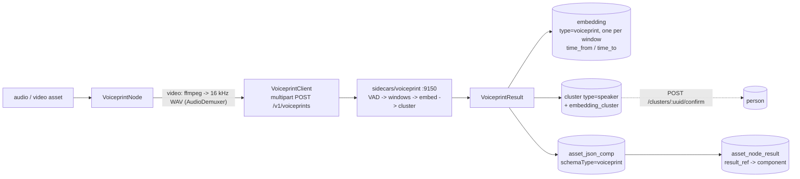

# Node: `voiceprint` — speaker embeddings and who-spoke-when

> **Status**: built end to end. Node `cortex/nodes/voiceprint`, sidecar `sidecars/voiceprint` (:9150,
> container with GPU), live-tested over the container's real port with all three backends.
> **Scope**: the node, its persistence, the model choice and how the backend is switched. The sidecar's
> HTTP contract and internals live in [../../../sidecars/VOICEPRINT_SIDECAR.md](../../../sidecars/VOICEPRINT_SIDECAR.md).
> **Related**: [../NODES.md](../NODES.md) (node system, rows for this node) ·
> [../NODE_DATA_TYPES.md](../NODE_DATA_TYPES.md) §4.3 (ports) ·
> [../../../workflows/WORKFLOW_FACE.md](../../../workflows/WORKFLOW_FACE.md) (the cluster → person loop this
> node reuses) · [../../../guidelines/NEW_NODE.md](../../../guidelines/NEW_NODE.md) ·
> customer docs `website/content/english/docs/nodes/voiceprint/index.adoc`.

## 1. What it does

The audio counterpart of `facedetect`. For an audio asset or a video's soundtrack it finds the speech,
cuts it into fixed windows (3 s, hop 1.5 s), embeds every window with a speaker-recognition model,
clusters the windows into speakers, and returns the speakers with their turns, one voiceprint per
speaker and one pooled voiceprint for the whole item.

## 2. Model choice

Chosen from the `voiceprint-eval` study (`/home/defaultuser/workspaces/dev/voiceprint-eval`,
`spec/FINDINGS.md` there): 22 approaches on Austrian and German speakers — VoxPopuli MEPs across
sessions, Common Voice, five degradations (3 s, telephone, MP3 24 kbit/s, babble 5 dB, reverb). Composite
EER in %, lower is better.

| Backend | Model | Composite EER | CPU ms / 10 s | Params | Licence | Commercial |
|---|---|---|---|---|---|---|
| `redimnet2` (default) | ReDimNet2-B6 LM, VoxCeleb2 | 0.43 | 870 | 12.4M | MIT | yes |
| `wespeaker` | WeSpeaker ResNet34-LM ONNX (= pyannote 3.1) | 0.74 | 292 | 6.6M | CC-BY-4.0 | yes, with attribution |
| `speechbrain` | ECAPA-TDNN | 1.28 | 197 | 22M | Apache-2.0 | yes |
| not offered | W2V-BERT 2.0 + MFA (VoxCeleb) | 0.43 | 2827 | 587M | Apache/MIT | yes — same accuracy, 47x the parameters |
| research only | ReDimNet2-B6 VoxBlink2 (+CN-Celeb) | 0.29 / 0.26 | ~900 | 12.5M | MIT code, NC data | **no** — `VOICEPRINT_REDIMNET2_DATASET` |

ReDimNet2-B6 (vox2) is the best model whose *training data* permits commercial use, and it is small.
The VoxBlink2 variants are better but VoxBlink2's authors forbid commercial application; HF mirrors that
tag them MIT/Apache are wrong. Commercial APIs (pyannoteAI, Speechmatics, Phonexia) were not measured.

## 3. Switching the backend

Three levels, cheapest first:

| Lever | Where | Effect |
|---|---|---|
| Node option `model` | pipeline definition / editor | Per node: `redimnet2`, `wespeaker`, `speechbrain`, or a full model id from `/v1/models`. Blank = the sidecar's default |
| `VOICEPRINT_DEFAULT_MODEL`, `VOICEPRINT_BACKENDS`, `VOICEPRINT_REDIMNET2_*`, `VOICEPRINT_WESPEAKER_REPO` | sidecar env | Per deployment: default backend, which backends exist, which checkpoint each loads (e.g. WeSpeaker ResNet293) |
| A new `Backend` class | `sidecars/voiceprint/voiceprint/backends/` | New model or a hosted API: implement `_load` + `_embed`, register in `_create`. VAD, windowing, clustering and the HTTP contract are shared |
| `voiceprintHost`/`voiceprintPort` | node options | Point the node at a different sidecar entirely, as `imagegen` does with its `port` |

The node never interprets the model: it stores the sidecar's `model` id on every row, so vectors of two
backends never share an `(embedding.type, embedding.model)` space and coexist after a switch.

## 4. Persistence

| Write | Rows | Key fields |
|---|---|---|
| `POST /assets/:uuid/embeddings/bulk` | one per window (`persistWindows=true`) or one per speaker | `type=voiceprint`, `nodeKind=voiceprint`, `model`=sidecar id, `subjectIndex`=window/speaker index, `frameNumber=0`, `timeFrom`/`timeTo` (ms), `normalized=true`, no `detectionUuid` |
| `POST /assets/:uuid/clusters/bulk` | one per speaker (only with windows) | `type=speaker`, `clusterIndex`, `score`=cohesion, `centroid`=speaker voiceprint, `meta.totalMs`, `meta.segments`; members = the speaker's window embeddings, `confidence`=cosine to the centroid, `origin=AUTO` |
| `POST /assets/:uuid/json-comps` | one | `schemaType=voiceprint`, `variant=""`, data = timeline without vectors |
| ledger | one | SUCCESS → `result_ref` the component; FAILED on sidecar/Loom error; SKIPPED "no speech found" |

`producerVersion` = `voiceprint/1:<model id>`.

**`embedding.time_from` / `time_to` were write-only-by-nobody.** V2.43 added the columns; the DAO
model, `EmbeddingImpl`, the REST request/response, the builder and the service never carried them. This
node threaded them through every layer (NEW_NODE §1.4) and `EmbeddingModelValidator` now rejects
`timeTo < timeFrom` and negative `timeFrom` — before, the table's `embedding_range_check` turned such an
item into a 500 that failed the whole bulk call.

## 5. Ports

| Port | Content type | Card. | Value |
|---|---|---|---|
| `audio` \| `video` (XOR `media_alt`) | `media/audio` \| `media/video` | ONE | the item, read via `ctx.media()` |
| `speaker_count` | `scalar/integer` | ONE | `Long` |
| `speakers` | `struct/embedding` | MANY | `{index, totalMs, cohesion, segments[{startMs,endMs}], vector}` per voice |
| `voiceprint` | `struct/embedding` | ONE | `{model, dim, vector}` pooled over all windows |
| `timeline` | `struct/segments` | ONE | `{durationMs, segments[{start, end, speaker, label}]}` sorted by start |
| `result` | `struct/json` | ONE | the persisted summary |

`ctx.preview(timeline, …)` writes a GFM table of the speakers (`speakersMarkdown`).

## 6. Key Classes Reference

| Class | Package / path | Purpose |
|---|---|---|
| `VoiceprintNode` | `io.metaloom.cortex.node.voiceprint` | the node: demux, call, emit, persist, cache |
| `VoiceprintNodeOptions` | same | options, `KEY="voiceprint"`, `EMBEDDING_TYPE`, `CLUSTER_TYPE`, `validate()` |
| `VoiceprintClient` | same | JDK HTTP/1.1 client, hand-built streamed multipart, `Params` |
| `VoiceprintResult` | same | parsed answer (records `Speaker`, `Window`, `Segment`), summary/timeline JSON |
| `AudioDemuxer` | same | `ffmpeg -vn -ac 1 -ar 16000` with wall clock and stderr tail |
| `VoiceprintNodeModule` | same | Dagger: `@IntoSet`, `@IntoMap @StringKey("voiceprint")`, options, client |
| `EmbeddingModelValidator` | `loom-shared/rest-model/.../validation` | time-window validation |

## 7. Configuration

| Option | Default | Notes |
|---|---|---|
| `voiceprintHost` / `voiceprintPort` | `localhost` / `9150` | |
| `model` | `` | blank = not sent |
| `windowSeconds` / `hopSeconds` / `minSpeechSeconds` | 3.0 / 1.5 / 1.0 | hop ≤ window |
| `clusterThreshold` | 0 | 0 = not sent = backend default (0.40 / 0.40 / 0.35) |
| `maxSpeakers` | 0 | 0 = not sent |
| `persistWindows` | true | false: one embedding per speaker, no clusters |
| `ffmpegPath` | `ffmpeg` | video only |
| `timeoutMs` | 0 | 0 = 10 min, for both demux and HTTP |

Sidecar env vars: [VOICEPRINT_SIDECAR.md](../../../sidecars/VOICEPRINT_SIDECAR.md).

## 8. Test Setup

| Test | Module | Covers |
|---|---|---|
| `VoiceprintNodeTest` (14) | node | ports, options → request, audio upload as-is, real ffmpeg demux + temp cleanup, missing ffmpeg FAILS, silence SKIPS, cache hit LOCAL, cache misses on options and rewrite, preview |
| `VoiceprintNodePersistenceTest` (5) | node | embeddings with time window, clusters + members, component, ledger; speaker-only mode; FAILED/SKIPPED rows |
| `VoiceprintClientTest` (4) | node | multipart wire format over HTTP/1.1 against a JDK `HttpServer`, parsing, HTTP errors |
| `VoiceprintOptionsValidationTest` (11), `VoiceprintNodePipelineTest` (6) | node | `validate()`; adapter, events, chaining, disabled, dry run |
| `EmbeddingDaoTest#shouldRoundTripTheTimeWindow` | `loom/db/jooq` | the time window round-trips; image rows stay null |
| `EmbeddingEndpointTest#testBulkCreateAudioWindowEmbeddings` | `loom/core` | bulk write + reload carry the window; inverted window = 1 failed item, not 500 |
| `VoiceprintNodeIntegrationTest` (2) | `integration-test` | stub sidecar → every row readable via REST; **live** sidecar on the two-voice fixture, skipped unless `/health` answers with `backends` |
| `sidecars/voiceprint/tests` | Python | 25 unit/contract tests (fake backend) + 7 live (real models) |

Run: `mvn -o -pl cortex/nodes/voiceprint/core test`; live IT needs `sidecars/voiceprint/container.sh run`.

## 9. Conventions and Gotchas

- **Clustering lives in the sidecar, not the node.** The cosine cut is a property of the model; the
  node sends a threshold only when the author set one.
- **`scalar/integer` is a `Long`.** `ValueCoercer` coerces it; an `OutputPort<Integer>` fails downstream
  with "expected Integer, got Long".
- **Silence is SKIPPED, unreachable sidecar or missing ffmpeg is FAILED** (NEW_NODE §5).
- **The demo seeds no voiceprint pipeline**: the demo container has no sidecar (same precedent as
  `tts`, `depthmap`, `imagegen`).
- **Biometric data.** Voiceprints used to identify people are GDPR Art. 9 data; the clusters are
  proposals for a human to confirm, never automatic names.
- **Cross-asset identity is not automatic**, exactly as for faces: two recordings of one person are two
  speaker clusters until a reviewer assigns both to one person.

## 10. Where do I find …?

| What | Where |
|---|---|
| Node | `cortex/nodes/voiceprint/core/src/main/java/io/metaloom/cortex/node/voiceprint/` |
| Sidecar | `sidecars/voiceprint/` (`server.py`, `voiceprint/backends/`, `container.sh`) |
| Two-voice fixture | `sidecars/voiceprint/tests/data/two_speakers.{wav,json}` (`tests/make_fixture.py`) |
| Docs recipe | `integration-test/.../node/docs/SidecarRecipes.java#voiceprint` |
| Model study | `/home/defaultuser/workspaces/dev/voiceprint-eval` (`spec/FINDINGS.md`, `report/index.html`) |

## 11. Progress Assessment

- [x] Sidecar with three switchable backends, container with GPU (CDI or `--gpus`), unit + live tests
- [x] Node, five registration touch-points, descriptors regenerated (46 kinds)
- [x] `embedding.time_from`/`time_to` readable and writable through every layer
- [x] Unit, persistence, pipeline, client, DAO, endpoint and integration tests (incl. live)
- [x] Website page, index rows, model licence rows, generated screenshots
- [ ] Cross-asset speaker search ("where else does this voice appear") — needs a query over
      `embedding` by `(type=voiceprint, model)`; the vector index spaces already separate by model
- [ ] AS-norm with an in-domain cohort and per-source threshold calibration (eval recommendation)
- [ ] Combine with `whisper` into speaker-attributed transcripts
- [ ] Overlapping speech: a window holding two voices is attributed to one
- [ ] Not in Helm, like every sidecar

---

_Git HEAD revision: `3da90863`_
_Last updated: 2026-10-10 (created with the node)_
