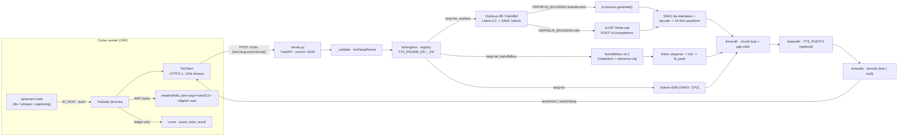

# TTS Sidecar — Technical Specification

Covers **`sidecars/tts/`** only: the FastAPI text-to-speech model server and its HTTP contract.
The Java consumer (`TtsNode`) is covered by [../features/nodes/NODES.md](../features/nodes/NODES.md);
node option deserialization by [../cortex/CONFIGURATION.md](../cortex/CONFIGURATION.md).
Sibling sidecar specs with the same shape: [ASR_SIDECAR.md](ASR_SIDECAR.md) (the other sidecar with
a backend registry), [VOICEPRINT_SIDECAR.md](VOICEPRINT_SIDECAR.md), [SIDECARS.md](SIDECARS.md)
(ports, cross-cutting conventions).

## Status

**Wired end to end.** A real Cortex consumer exists — `io.metaloom.cortex.node.tts.TtsNode`
(kind `tts`, Dagger-bound in `TtsNodeModule`, descriptor in `TtsDescriptorProvider`, unit +
pipeline + persistence + integration tests). This sidecar is not standalone or experimental.

Since 2026-10-11 the server is a **package with an engine registry** rather than one file, carrying
the audio-processing chain and the second German engine backported from the sibling `tts-server`
project (`/home/defaultuser/workspaces/dev/tts-server`, which has its own `spec/`). What that
backport brought, and what it closed:

| Area | State |
|---|---|
| Engine registry (`tts/engines/`), one engine bound per language per process | done — adding a model is a module plus one registry branch |
| Kartoffelbox German engine (Chatterbox fine-tune, voice cloning) | done, not yet exercised on a GPU **in this checkout** |
| Audio chain: chunking, edge trim, peak headroom, phase dispersion, reference leveling | done, measured by `tests/test_audio.py` |
| Post-production chain (`TTS_POSTFX`) | done, `off` by default; verified live at -19.0 LUFS on both routes |
| `format` honoured (`wav` / `mp3`) | done — an unknown container is a 400, not a silent WAV |
| Streaming (`POST`/`GET /v1/tts/stream`) | done; incremental (inside one generation) only on Orpheus |
| Catalogue derived from configuration (`/v1/models`, `/voices`) | done, loads no model |
| Python tests | done — 166, every engine mocked, no GPU and no network |
| `TTS_PORT` read by Python, device variable namespaced (`TTS_DEVICE`) | done, closes two hazards in [SIDECARS.md](SIDECARS.md) §Environment |
| Container image / Helm wiring | missing — still started by hand with `run.sh` |
| Live-sidecar integration test from the JVM | missing — every Java test stubs `TtsClient` |
| Concurrency | partial — one lock per engine serialises generations; there is no queue and no admission control |

Two honest caveats carried over:
- **Nothing deploys it.** `helm/cortex` contains no sidecar container, no port `9100`, no `TTS_*`
  env, and there is no Dockerfile or compose file for this sidecar.
- **No test in the repo talks to a live sidecar.** The Python suite mocks every engine on purpose,
  so the contract stays checkable on a laptop; what a GPU path *sounds* like is still manual.

## 1. Architecture



Why the sidecar exists at all: Orpheus is an **LM that emits SNAC audio tokens, not audio**. vLLM
can run the LM, but the 7-token SNAC frame de-interleave and `SNAC.decode()` must happen somewhere.
It happens here, in both backends. The JVM node never loads a model.

### 1.1 Module map

| Path | What |
|---|---|
| `server.py` | the HTTP surface only: the request model, `_validate`, the five routes, the lifespan log |
| `tts/config.py` | **every** environment variable, read once at import. The configuration reference. |
| `tts/engines/base.py` | the `Engine` contract: declare, `_generate`, `finish`. The three rules a subclass must not break. |
| `tts/engines/__init__.py` | the registry: name -> instance, language -> bound engine, loud fallback |
| `tts/engines/orpheus.py` | SNAC layout and decode, both backends, the incremental window, the token streamer |
| `tts/engines/kartoffelbox.py` | base-plus-T3 load, reference clips, conditioning, the generation seam |
| `tts/engines/kokoro.py` | Kokoro ONNX; the one engine whose voice list is authoritative |
| `tts/chunking.py` | text -> chunks at sentence/clause/word seams; the short-tail rule |
| `tts/audio.py` | containers (`encode`, the two stream encoders) and the waveform stages |
| `tts/postfx.py` | the optional post-production chain |
| `tts/synth.py` | the engine-agnostic chunk loop, for a file and for a stream |
| `tools/make_reference_voices.py` | renders Kartoffelbox reference clips from a running Orpheus server |
| `voices/kartoffelbox/*.wav` | the five synthetic clips that ship with the sidecar (tracked in git) |
| `tests/` | 166 tests; `conftest.py` holds `FakeEngine` and the Kartoffelbox fixtures |

## 2. HTTP contract (as implemented)

Base URL `http://{ttsHost}:{ttsPort}`, default `http://localhost:9100`.

### 2.1 `POST /v1/tts`

Request — `application/json`, pydantic `TTSRequest`:

| Field | Type | Default | Notes |
|---|---|---|---|
| `text` | string | *(required)* | 400 if missing or blank |
| `lang` | string | `"de"` | matched by case-insensitive **prefix** against the bound languages, so `de-DE` / `en-US` work |
| `voice` | string | `"Jakob"` | German: warned about but never rejected. English: validated against the voices file (400). |
| `format` | string | `"wav"` | `wav` or `mp3`. **Honoured** since 2026-10-11; an unknown value is a 400. |

There is deliberately **no `model` field**: the engine is bound to the process. See §4.

Response — `200`, `audio/wav` (PCM_16) or `audio/mpeg`, raw bytes. 24 kHz mono for every engine
shipped today. The synthesis runs in a worker thread, so `/health` keeps answering during a long
recording.

### 2.2 `POST /v1/tts/stream` and `GET /v1/tts/stream`

The same request (the GET form takes `text`, `lang`, `voice`, `format` as query parameters), answered
as a chunked response that starts before the synthesis has finished. The GET form exists so a
browser can play it with `<audio src="...">` and no JavaScript.

Both routes go through the same `_validate`, so a stream refuses exactly what the file refuses. The
first chunk is produced **before** the response starts, which is what keeps every refusal a status
code instead of an empty `200`. A failure part way through re-raises and the connection drops: a
truncated stream that ends politely is indistinguishable from a finished recording.

Headers: `Cache-Control: no-store`, `X-Accel-Buffering: no` (nginx would otherwise buffer the whole
body and the endpoint would stream in name only).

### 2.3 `GET /v1/models`

What the running process can speak with, loading nothing:

```json
{"default_lang":"de","default_format":"wav","formats":["mp3","wav"],"languages":["de","en"],
 "postfx":{"mode":"off","modes":["off","level","clean","podcast","broadcast"],"target_lufs":null},
 "streaming":{"endpoint":"/v1/tts/stream","formats":["mp3","wav"],"chunk_chars":200,"incremental":true},
 "models":[{"id":"orpheus-de","engine":"orpheus","repo":"...","backend":"transformers",
            "languages":["de"],"voices":["Jakob","Anton","Julian","Sophie","Marie"],
            "sample_rate":24000,"device":"cuda","licence":"...","commercial":false,
            "loaded":false,"available":true,"chunk_chars":500,"max_seconds":49.92,
            "incremental":true}, ...]}
```

`loaded` / `available` are the readiness `/health` cannot give: this deployment has answered
`{"status":"ok"}` while every German request failed with CUDA OOM.

### 2.4 `GET /voices`

The older per-language projection of the same data:
`{"de":{"engine":...,"repo":...,"voices":[...]},"en":{...}}`. It projects `/v1/models`, so the two
cannot disagree — the previous static map advertised six German voices even for the single-speaker
Thorsten checkpoint.

### 2.5 `GET /health`

`{"status":"ok","engines":{"de":"orpheus","en":"kokoro"},"orpheus_backend":"transformers",
"device":"cpu","formats":["mp3","wav"],"streaming":true,"postfx":"off"}`.

Liveness only. `orpheus_backend` is kept although it means nothing when Kartoffelbox is bound: it is
a published field and removing one is a breaking change for a probe nobody versions.

### 2.6 Errors

FastAPI `{"detail": "..."}` JSON:

| Code | Raised when |
|---|---|
| `400` | blank `text`; a `lang` no bound engine claims; an unknown `format`; an unknown **English** voice |
| `422` | pydantic rejects the body (missing `text`, wrong types) — FastAPI default |
| `500` | any synthesis exception (`synthesis error: ...`): SNAC layout mismatch, too-few-token frames, a missing engine dependency, a waveform that is not 1-D, an empty generation |
| `502` | `ORPHEUS_BACKEND=vllm` and the upstream `/v1/completions` returned non-200 (body truncated to 500 chars) |
| `503` | `lang=en` and the Kokoro weights are missing on disk (`run setup.sh`) |

Neither `/health` nor `/voices` is called by any Java code; they are operator-only.

## 3. The engine registry

`Engine` (`tts/engines/base.py`) is `generate(text, voice) -> (waveform, rate)` plus declarations.
Everything an engine does *not* do is shared: the routes, `_validate`, the chunk loop, the gap
welding, the containers, the post-production chain and both catalogue routes.

| Declaration | Meaning |
|---|---|
| `name`, `languages`, `backend`, `repo` | identity, and what the catalogue reports |
| `sample_rate` | declared, never read from a loaded model — the catalogue must not force a load |
| `chunk_chars` | text budget for ONE generation; `0` means "no ceiling, do not split a file" |
| `min_chunk_chars` | a trailing chunk shorter than this is welded onto its predecessor; `0` off |
| `max_seconds` | the duration ceiling, used to warn that a generation ran into it |
| `min_seconds` | the floor below which a result is not speech but a fragment; `0` off |
| `incremental` | True only for an engine that can stream from inside one generation |
| `licence`, `commercial` | reported by `/v1/models`, for the model-licence page |

| Hook | Contract |
|---|---|
| `_generate(text, voice)` | the engine's own synthesis. Called under the engine's lock. |
| `finish(waveform, rate)` | per-generation audio stages. **After** the duration checks, so those see what the engine produced. Identity by default. |
| `stream(text, voice)` | one generation as pieces. Default: a single piece (still a chunk-granular stream). |
| `voices()` / `available` / `loaded` / `startup_note()` | catalogue and diagnostics; must load nothing |

### 3.1 Adding a model

1. `tts/engines/<name>.py` with the subclass; import its dependencies **inside the module**, so a
   process that does not use the engine never imports them.
2. the name in `_NAMES` and one branch in `_create` (`tts/engines/__init__.py`).
3. optionally a `TTS_ENGINE_<LANG>` entry in `config.ENGINE_BY_LANG`.

Nothing in `server.py` changes. `tests/test_engines.py` has the registry tests a new engine inherits
(fallback on a typo, one instance per process, the catalogue listing the bound engine only).

### 3.2 Orpheus: the SNAC contract

Invariants that produce **noise instead of speech** when broken, all pinned by tests:

1. `TOK_AUDIO_BASE = 128266`, `CODEBOOK_SIZE = 4096`, `FRAME = 7` and the 1/2/3/3/2/3/3 interleave
   are a contract with the checkpoint. Change them only together with the checkpoint, never to
   "make the range check pass".
2. The range check in `to_snac_layers` is the tripwire. Clamping or `% 4096` would turn a loud
   failure into audible garbage.
3. Both backends must produce the same code values: `id - 128266` and `N - 10` agree *because*
   `custom_token_N` has id `128256 + N`. Touch one and re-derive the other.
4. A partial trailing frame is dropped, never padded. Fewer than one frame is an error (500), not
   empty audio.
5. The incremental decoder emits every frame exactly once, in order. Its window carries context
   because SNAC is convolutional; `TTS_STREAM_WINDOW_FRAMES` must stay >= 2.

### 3.3 Kartoffelbox: cloning, and why it needs the audio chain

- The checkpoint ships **only** the retrained T3 stage, so the load is "English base Chatterbox,
  then swap T3" plus the German repo's own `conds.pt` as the default voice.
- It has **no speakers**. A voice is a reference clip in `KARTOFFELBOX_VOICES_DIR` or the shipped
  `voices/kartoffelbox/`, matched on the filename stem, case-insensitively. **A voice is never a
  path**: the name is matched against a *listing*, so a traversal simply misses.
- It reproduces a clip's **level and dynamics** one-for-one. A loud clip is cloned clipping; a
  bursty clip is cloned shouting single syllables with saturated harmonics, which no peak stage can
  undo because the waveform never clips. Hence `level_reference` + `even_out_reference` on the way
  in, and `disperse` + `trim_edges` + `fit_peak` on the way out.
- Its generation ceiling is **tighter** than Orpheus's (~40 s against 49.92 s), and it degrades on
  very **short** inputs — so its chunk budget has a floor as well as a ceiling.
- Its vocoder hard-clips at ±0.99 internally; the load lifts that clamp so the linear peak gain is
  the only ceiling.
- Outputs carry a `resemble-perth` watermark by default. `KARTOFFELBOX_WATERMARK=0` installs a
  dummy watermarker — a deliberate act, never a default.

## 4. Which German engine, and why it is a process-level choice

**Kartoffelbox is the better German voice; Orpheus/Kartoffel is outdated.** Measured on identical
text with torchaudio `SQUIM_OBJECTIVE` (reference-free, so these are estimates): PESQ mean 3.59
against 3.07, and every voice improving over the Kartoffel speaker it clones (`Sophie` 2.97 ->
3.82, `Marie` 3.33 -> 3.86). Orpheus is also band-limited to ~8 kHz where Kartoffelbox reaches
11-12 kHz, and several of its speakers are unstable. Confirmed by listening, 2026-10-09.

The code default stays `orpheus`: it is what `setup.sh` installs without `KARTOFFELBOX=1`, and the
Chatterbox stack needs `--no-deps` plus a curated dependency set. Switching a deployment is
`TTS_ENGINE_DE=kartoffelbox`; the five shipped clips mean `voice` works immediately.

Orpheus is still the **generator for the reference clips** (`tools/make_reference_voices.py`), so
the code path is not dead even where the voice is not used.

**The engine is bound to the process, not to the request.** Two load-bearing reasons: `TtsClient`
sends only `{text, lang, voice, format}`, so the wire does not change when a deployment switches;
and only one engine per language may be resident, because two multi-GB checkpoints on one GPU is a
memory profile nobody chose and there is no unload path. It follows that `/v1/models` lists the
bound engine only — never both German ones.

## 5. The audio chain

Each stage is the one place its job is done. All of them exist because of a defect **no other
measure sees**: byte count, duration and word count all look right with and without them.

| Stage | Where | The defect it fixes |
|---|---|---|
| chunking | `tts/chunking.py` | past the engine's ceiling a generation returns a well-formed file cut off mid-word, with no error anywhere |
| edge trim | `audio.trim_edges` | engines leave ~0.10 s before and ~0.15 s after the speech; across a weld that became a 0.5-0.6 s hole once every ~7 s of a streamed recording |
| phase dispersion | `audio.disperse` | the HiFT vocoder ticks once per pitch period (kurtosis 7-9 against 5 for human speech in 2-8 kHz): heard as buzz and "pops", invisible to every magnitude measure |
| reference leveling | `audio.level_reference`, `audio.even_out_reference` | the clone copies the clip's level and bursts |
| peak headroom | `audio.fit_peak` | measured peaks of 1.15 (+1.2 dBFS), 140-240 samples per 25 s past 1.0: hard-clipped by the WAV writer, clipped again by an MP3 decoder |
| post-production | `tts/postfx.py` | optional loudness/EQ/compression to a fixed delivery level |

### 5.1 The rule every stage follows: a gain, never a curve

The first versions of three of these stages bent individual samples and all three added harmonics
to the loudest syllables of the voices they were meant to protect — reported as "übersteuert":

| Stage, first version | What it did | Measured |
|---|---|---|
| `fit_peak` as a `tanh` soft knee above -3 dBFS | reshaped single samples | 253 shaped 10 ms windows in one 25 s sample |
| pedalboard `Compressor` | 3-5 ms **peak** attack, faster than one period of a 120 Hz voice | THD -37 dB (`podcast`), -30 dB (`broadcast`) |
| look-ahead limiter releasing in 5 ms | gain fluttered on loud syllables | audible |

The replacements are a whole-waveform linear gain, an **RMS** compressor over a 30 ms window with a
hold-and-release, and a limiter whose curve moves in ramps of at least the look-ahead. Measured THD
now **-69 dB or better in every mode**, with the loudness target unchanged. `tests/test_postfx.py`
measures exactly this (THD per mode at 100/120/220 Hz, gain wobble above 30 Hz, release rate), so
the regression cannot come back quietly.

**Known weak spot.** The two loudness gains are measured on the first stream piece that is at
least 0.5 s long and then held, because a stream cannot know its future and a gain re-measured per
piece would pump. Orpheus's *incremental* pieces are one SNAC window each (~85 ms), so with
`TTS_POSTFX` on and `TTS_STREAM_INCREMENTAL=1` neither gain is ever measured: the EQ, the
compressor and the limiter still run, but the delivery loudness is not reached. Kartoffelbox streams
whole chunks, so its first piece is long enough. Until that is fixed, a deployment that wants both
should set `TTS_STREAM_INCREMENTAL=0` (chunk-granular streaming, still a stream).

`POSTFX_CHAINS` holds the per-mode EQ and compressor settings; `-19 LUFS` is the default target
because the output is **mono** (the -16 LUFS podcast norm is for stereo, and a mono file played on
both speakers sounds ~3 dB louder). Verified live 2026-10-11: -19.0 LUFS on both the file and the
stream route, peak at the -1.5 dBFS limiter ceiling.

## 6. Environment variables

Read by `tts/config.py` at **import time** — changing one requires a restart. A relative model or
voice path resolves against the **sidecar directory**, not the working directory.

### 6.1 Server and routing

| Var | Default | Meaning |
|---|---|---|
| `TTS_HOST` | `0.0.0.0` | bind host, read by Python (so `run.sh` and `python server.py` agree) |
| `TTS_PORT` | `9100` | bind port, likewise. `9100` is the `TtsNode` default — changing it breaks the caller. |
| `TTS_ENGINE_DE` | `orpheus` | `orpheus` or `kartoffelbox`; an unknown value falls back loudly |
| `TTS_ENGINE_EN` | `kokoro` | — |
| `TTS_DEVICE` | `auto` | torch device for the German engines. `DEVICE` is honoured as a fallback for compatibility; Kokoro is ONNX/CPU and ignores both. |

### 6.2 Orpheus / Kartoffel

| Var | Default | Meaning |
|---|---|---|
| `ORPHEUS_BACKEND` | `transformers` | `transformers` = in-process LM; `vllm` = proxy the LM and decode SNAC locally. An unknown value falls back loudly. |
| `ORPHEUS_LLM_ENDPOINT` | `http://localhost:8000` | base URL for the `vllm` backend; `/v1/completions` is appended |
| `ORPHEUS_REPO_DE` | `SebastianBodza/Kartoffel_Orpheus-3B_german_natural-v0.1` | **HF-gated** — needs an accepted licence and `HF_TOKEN`, or set `Thorsten-Voice/tv-orpheus-v1` (ungated, Apache-2.0, single speaker `thorsten`) |
| `ORPHEUS_REPO_DE_MODEL` | *(value of `ORPHEUS_REPO_DE`)* | the `model` field sent to vLLM, when it announces a different id |
| `SNAC_REPO` | `hubertsiuzdak/snac_24khz` | SNAC decoder repo |

### 6.3 Kartoffelbox

| Var | Default | Meaning |
|---|---|---|
| `KARTOFFELBOX_REPO` | `SebastianBodza/Kartoffelbox-v0.1` | HF-gated; only the T3 stage |
| `KARTOFFELBOX_T3_FILE` | `t3_cfg.safetensors` | the file swapped into the base model |
| `KARTOFFELBOX_VOICES_DIR` | `models/kartoffelbox-voices` | a deployment's own reference clips |
| `KARTOFFELBOX_BUILTIN_VOICES_DIR` | `voices/kartoffelbox` | the five shipped clips; `""` switches them off |
| `KARTOFFELBOX_EXAGGERATION` / `_CFG_WEIGHT` / `_TEMPERATURE` | `0.5` / `0.3` / `0.6` | upstream's generation defaults |
| `KARTOFFELBOX_REF_RMS_DB` | `-23` | the speech level every reference clip is brought to |
| `KARTOFFELBOX_REF_EVEN_DB` / `_RATIO` | `4` / `4` | how far above the clip's median speech level a burst is compressed, and by how much (`RATIO=1` off) |
| `KARTOFFELBOX_DISPERSION_MS` / `_FROM_HZ` | `8` / `2000` | the all-pass that spreads the vocoder tick (`0` off) |
| `KARTOFFELBOX_VOCODER_LIMIT` | `4.0` | what S3Gen's internal ±0.99 clamp is raised to |
| `KARTOFFELBOX_CHUNK_CHARS` / `_MIN_CHUNK_CHARS` | `300` / `60` | its own text budget, and the floor below which a tail is absorbed |
| `KARTOFFELBOX_WATERMARK` | `1` | `0` installs a dummy watermarker |

### 6.4 Kokoro

| Var | Default | Meaning |
|---|---|---|
| `KOKORO_MODEL` | `models/kokoro-v1.0.onnx` | relative to the sidecar directory |
| `KOKORO_VOICES` | `models/voices-v1.0.bin` | also the voice catalogue (an npz index) |

### 6.5 Audio chain and streaming

| Var | Default | Meaning |
|---|---|---|
| `TTS_CHUNK_CHARS` | `500` | Orpheus text budget per generation (~33 s at 15 chars/s) |
| `TTS_CHUNK_GAP_MS` | `180` | silence welded between two chunks |
| `TTS_EDGE_SILENCE_DB` | `-40` | the level under which a 10 ms window counts as silence |
| `TTS_EDGE_KEEP_MS` | `30` | silence kept on each side so a soft onset survives the trim |
| `TTS_PEAK_CEILING_DB` | `-1` | output headroom (1 dB, because MP3 overshoots its input by ~5 %) |
| `TTS_POSTFX` | `off` | `off`, `level`, `clean`, `podcast`, `broadcast`; an unknown value falls back loudly |
| `TTS_POSTFX_LUFS` | `-19` | delivery loudness (mono; -19 mono is about -16 stereo) |
| `TTS_POSTFX_CEILING_DB` | `-1.5` | limiter ceiling, under the peak ceiling on purpose |
| `TTS_STREAM_CHUNK_CHARS` | `200` | streaming budget; the time-to-first-audio when not incremental |
| `TTS_STREAM_INCREMENTAL` | `1` | stream from inside one generation (Orpheus only) |
| `TTS_STREAM_WINDOW_FRAMES` | `4` | SNAC context window for the incremental decode; >= 2 |

Read by `setup.sh`: `PYTHON` (venv interpreter), `KARTOFFELBOX` (`1` also installs the Chatterbox
stack). Implicitly honoured by `transformers` / `huggingface_hub`: `HF_TOKEN`, `HF_HOME` — **both**
German checkpoints are gated, so one of them is needed either way.

## 7. Node-side options (the other half of the wire)

`TtsNodeOptions` (block `tts` in the Cortex options file) — defaults from code:

| Option | Default | Effect |
|---|---|---|
| `ttsHost` | `localhost` | validated non-blank |
| `ttsPort` | `9100` | validated `> 0` |
| `language` | `de` | sent as `lang`; validated non-blank |
| `voice` | `Jakob` | sent as `voice`; **not validated** against the engine |

Ports: `text` (`TEXT_ANY`, ONE) in -> `audio` (`ARTIFACT_AUDIO`, ONE) + `flag` (`SCALAR_STRING`,
`DONE`/`FAILED`) out. `defaultConcurrency = 1` — one sidecar holds one model on one device, so
parallel calls only queue. The descriptor also exposes `timeoutMs` (default `0`), which
`TtsNodeOptions` does **not** have a field for — descriptor/option drift, see §9.

There is no node option for the engine, the format or the post-production mode, and that is
deliberate: see §4. A node-side option would have to be sent per request, which the memory profile
does not allow.

## 8. Test setup

### 8.1 The Python suite

```bash
cd sidecars/tts
./setup.sh                              # venv + Kokoro weights + requirements-dev.txt
.venv/bin/python -m pytest tests -q     # 166 tests, ~1.4 s
```

No torch, no transformers, no snac, no chatterbox, no kokoro-onnx, no GPU and no network: every
engine is replaced at the one seam the chunk loop calls. Where an engine's own plumbing is under
test, the model is a fake and `torch` is a stub in `sys.modules`.

| File | Tests | What it pins |
|---|---|---|
| `tests/conftest.py` | — | `FakeEngine`, the Kartoffelbox fixtures, a fresh registry per test |
| `tests/test_server.py` | 41 | the request contract, both containers, the catalogue, the chunk loop end to end, every streaming guarantee |
| `tests/test_chunking.py` | 13 | budgets, seams, nothing lost or reordered, the short-tail rule |
| `tests/test_audio.py` | 18 | the trim, the headroom gain, the all-pass, reference leveling and evening |
| `tests/test_postfx.py` | 42 | the loudness target per mode and level, **THD per mode**, gain wobble, release rate, stream == file |
| `tests/test_engines.py` | 52 | the registry, the SNAC window, the vLLM SSE parser, Kartoffelbox clips and seam, Kokoro |

What the suite deliberately does **not** cover: how a GPU path sounds, the real SNAC layout against
a real checkpoint, and the incremental decode on a live model.

### 8.2 Manual smoke test

```bash
curl -s -X POST localhost:9100/v1/tts -H 'Content-Type: application/json' \
  -d '{"text":"Guten Tag, dies ist ein Test.","lang":"de","voice":"Jakob"}' -o de.wav
curl -s -X POST localhost:9100/v1/tts -H 'Content-Type: application/json' \
  -d '{"text":"Hello, this is a test.","lang":"en","voice":"af_heart","format":"mp3"}' -o en.mp3
curl -s "localhost:9100/v1/tts/stream?text=Guten+Tag&format=mp3" -o stream.mp3
```

Verify the output is real speech and not silence — a file of the right size can still be silence,
which is exactly what a SNAC layout mismatch produces. `audio-eval/tools/check_outputs.py` in the
sibling `audio-eval` checkout does this; do not invent a local substitute.

### 8.3 Java-side tests, all sidecar-free

| Test | Path | What it pins |
|---|---|---|
| `TtsNodeTest` | `cortex/nodes/tts/core/src/test/java/io/metaloom/cortex/node/tts/TtsNodeTest.java` | mocked `TtsClient`; WAV lands in `tts_bin`, ports emitted, self-skip on blank text |
| `TtsNodePersistenceTest` | same dir | exactly one `asset_node_result` row, `nodeKind=tts`, no `result_ref`; FAILED row on error |
| `TtsNodePipelineTest` | same dir | pipeline adapter, event dispatch, output chaining |
| `TtsOptionsValidationTest` | same dir | defaults `localhost:9100` and the validation rules |
| `TtsClientHttpTest` | same dir | the HTTP/1.1 client, request shape, error mapping |
| `TtsNodeIntegrationTest` | `integration-test/src/test/java/io/metaloom/loom/test/integration/node/TtsNodeIntegrationTest.java` | stub client returning fixed bytes; ledger row read back over REST |
| `NodePortConformanceTest` | same dir as above | descriptor ports match `TtsNode`'s declared ports |

Running Cortex/Loom tests still needs the pooled test DB — see the repo `CLAUDE.md`
(`./setup-pool.sh`).

## 9. Conventions and Gotchas

- **Configuration is environment-only, and captured at import.** No config file, no CLI flags, no
  request-level override of engine, backend, format defaults or post-production mode.
- **Never run uvicorn with `--workers N`.** Each worker is a process and would load its own full
  copy of the engine onto the same GPU. `run.sh` starts one process on purpose.
- **A relative path is resolved against `sidecars/tts/`,** not the working directory. The older
  behaviour failed quietly for Kartoffelbox: no clips found, every request falling back to the
  checkpoint's default conditioning, and only the sound saying so.
- **The catalogue routes must never load a model.** German voices are a directory listing or a
  property of the configured checkpoint id; English voices come from the npz *index*. This is also
  why `sample_rate` is declared rather than read from the model.
- **`/v1/tts` returns raw audio bytes, and WAV stays the default.** `TtsClient` reads the body as a
  waveform. Errors are the only JSON responses.
- **A request field must never lie.** `format` sat on the model, defaulted and unread, so a caller
  asking for mp3 got wav and could not tell. Anything accepted is honoured or rejected with a 400.
  The same rule is why `/v1/models` reports `incremental: false` for Kartoffelbox however
  `TTS_STREAM_INCREMENTAL` is set.
- **HTTP/1.1 is forced** in `TtsClient` (`Version.HTTP_1_1`) because FastAPI rejects the JDK
  client's default HTTP/2 upgrade. Do not remove it. Same trick as `SmolVLMClient`.
- **The two Orpheus backends build the same prompt from one function** (`prompt_text`), but wrap it
  differently: `transformers` tokenizes and adds raw ids, `vllm` sends the literal
  `<|begin_of_human|>…<|eot_id|><|end_of_human|>`. A prompt change must keep them equivalent.
- **`<custom_token_N>` -> SNAC code `N - 10`.** If a checkpoint renumbers custom tokens this
  silently produces garbage audio, not an error.
- **A streamed vLLM delta can end mid-token.** Only the text up to the last `>` is scanned; the
  remainder waits for the next delta. Reading `ken_11>` as a token would invent a code.
- **Models load lazily into instance state and are never unloaded**, and a loader assigns its
  handle last, so a failed download leaves `None` and the next request retries.
- **German voices are warned about, never rejected; English voices are validated.** The German
  speaker set is a convention of the training data; the English one comes out of the voices file.
- **`chatterbox-tts` is installed with `--no-deps`** and a curated list
  (`requirements-kartoffelbox.txt`), pinned to `0.1.7` because both that list and the T3 key set
  are version-specific. Its own pins would downgrade torch underneath Orpheus and add `gradio`.
- **The shipped reference clips are synthetic** (rendered from the Kartoffel speakers of the same
  names) and tracked in git. Recordings of real people stay out of the repository: a published
  voice cannot be retracted.
- **Ledger-only persistence.** The WAV stays in `metaPath/tts_bin/<segment>/<sha512>-<digest>.wav`
  (digest = first 12 hex of SHA-256 over language, voice and text); Loom gets an
  `asset_node_result` row with no `result_ref`, because no byte-ingest endpoint for produced media
  exists — see [../concept/REST_CORTEX_METADATA_BINARY_HANDLING_PLAN.md](../concept/REST_CORTEX_METADATA_BINARY_HANDLING_PLAN.md).
  Wiring `audio` into `s3-sink` is the only way to keep the bytes, and the sink must run on the
  **same worker**.
- **`producerVersion` is `"{language}:{voice}"`**, not a model id. Changing `TTS_ENGINE_DE` or
  `ORPHEUS_REPO_DE` on the sidecar does not invalidate anything on the Loom side — a cached result
  from the old engine is still served. Re-run with a changed `voice`, or clear `tts_bin`.
- **`timeoutMs` exists in the descriptor but not in `TtsNodeOptions`.** The effective budget is the
  hardcoded `TtsClient` 120 s request / 30 s connect timeout. A long text now costs several
  generations in one request, so this matters more than it did: ~15 chars/s of German means a 1300
  character text is close to 90 s.
- **Port allocation:** `9100` tts, `9110` sentiment, `9120` depthmap, `9130` sam2, `9140` asr,
  `9150` voiceprint, `9200`/`9210` imagegen, `9220` videogen. Do not reuse `9100`.
- **Licensing:** both German checkpoints are gated and not commercially clean; Kokoro-82M is
  Apache-2.0; Chatterbox output carries a watermark by default. `/v1/models` reports `licence` and
  `commercial` per engine. See `website/content/english/docs/legal/model-licenses/`.

## 10. Key Classes Reference

| Name | Path | Purpose |
|---|---|---|
| `server.py` | `sidecars/tts/server.py` | the HTTP surface: request model, `_validate`, five routes |
| `config` | `sidecars/tts/tts/config.py` | every environment variable, resolved paths, loud fallbacks |
| `Engine` | `sidecars/tts/tts/engines/base.py` | the engine contract and the generation guards |
| registry | `sidecars/tts/tts/engines/__init__.py` | name -> instance, language -> bound engine, startup log |
| `OrpheusEngine` | `sidecars/tts/tts/engines/orpheus.py` | SNAC layout, both backends, incremental window |
| `KartoffelboxEngine` | `sidecars/tts/tts/engines/kartoffelbox.py` | Chatterbox load, clips, conditioning, finish stages |
| `KokoroEngine` | `sidecars/tts/tts/engines/kokoro.py` | Kokoro ONNX, authoritative voice list |
| `encode` / `WavStream` / `Mp3Stream` | `sidecars/tts/tts/audio.py` | containers for a waveform and for a sequence |
| `trim_edges` / `fit_peak` / `disperse` / `level_reference` | `sidecars/tts/tts/audio.py` | the waveform stages |
| `PostFx` / `RmsCompressor` / `lookahead_limit` | `sidecars/tts/tts/postfx.py` | the post-production chain |
| `split_for_synthesis` / `absorb_short_tail` | `sidecars/tts/tts/chunking.py` | text -> generations |
| `synthesize` / `stream_pieces` / `stream_bytes` | `sidecars/tts/tts/synth.py` | the engine-agnostic chunk loop |
| `TtsClient` | `cortex/nodes/tts/core/src/main/java/io/metaloom/cortex/node/tts/TtsClient.java` | JDK HttpClient POST to `/v1/tts`, returns WAV bytes |
| `TtsNode` | `.../tts/TtsNode.java` | port wiring, `tts_bin` write, result cache, ledger record |
| `TtsNodeOptions` | `.../tts/TtsNodeOptions.java` | `ttsHost`/`ttsPort`/`language`/`voice` + validation |
| `TtsNodeModule` | `.../tts/TtsNodeModule.java` | Dagger bindings, `@StringKey("tts")`, `TtsClient` provider |
| `TtsDescriptorProvider` | `loom-shared/node-model/src/main/java/io/metaloom/loom/nodes/spec/TtsDescriptorProvider.java` | UI/editor descriptor: ports, parameters, `defaultConcurrency=1` |
| Sidecar index | `sidecars/README.md` | port table for all sidecars + deployment note |

## 11. Where do I find ...?

| I want to ... | Look at |
|---|---|
| the HTTP contract | §2, and `sidecars/tts/server.py` |
| every setting and its default | `sidecars/tts/tts/config.py` (§6 mirrors it) |
| how to add another speech model | §3.1, and `sidecars/tts/tts/engines/__init__.py` |
| why the audio chain exists, stage by stage | §5, and `sidecars/tts/tts/audio.py` |
| why a post-production stage may not be a curve | §5.1, and `tests/test_postfx.py` |
| which German engine to run | §4 |
| how a reference clip becomes a voice | §3.3, `tools/make_reference_voices.py` |
| which port | `sidecars/README.md`, `TtsNodeOptions.ttsPort` = `9100` |
| how the node consumes it | `cortex/nodes/tts/core/.../TtsNode.java`, [../features/nodes/NODES.md](../features/nodes/NODES.md) |
| node options schema / defaults | `TtsDescriptorProvider`, [../cortex/CONFIGURATION.md](../cortex/CONFIGURATION.md) |
| port types + cardinality rules | [../features/nodes/NODE_DATA_TYPES.md](../features/nodes/NODE_DATA_TYPES.md) |
| where the WAV bytes go | `metaPath/tts_bin/...`; [../features/nodes/NODES.md](../features/nodes/NODES.md) |
| why nothing is uploaded to Loom | [../concept/REST_CORTEX_METADATA_BINARY_HANDLING_PLAN.md](../concept/REST_CORTEX_METADATA_BINARY_HANDLING_PLAN.md) |
| metrics emitted (`recordAiCall`/`recordAiCacheHit` with `"tts"`) | [../features/ops/METRICS.md](../features/ops/METRICS.md) |
| customer-facing docs | `website/content/english/docs/nodes/tts/index.adoc` |
| model licence posture | `website/content/english/docs/legal/model-licenses/index.adoc` |
| another sidecar with a backend registry | `sidecars/asr/`, `sidecars/voiceprint/`; [ASR_SIDECAR.md](ASR_SIDECAR.md) |
| how to add a new node + sidecar | [../guidelines/NEW_NODE.md](../guidelines/NEW_NODE.md) |
| the upstream project this was backported from | `/home/defaultuser/workspaces/dev/tts-server` and its `spec/` (not part of this checkout) |

## 12. Progress Assessment

### Built
- [x] `POST /v1/tts` with `text` / `lang` / `voice` / `format`, returning `audio/wav` or `audio/mpeg`
- [x] `format` honoured in one place; an unknown container is a 400
- [x] `POST` and `GET /v1/tts/stream`, primed so a refusal is still a status code
- [x] Engine registry: one engine bound per language per process, loud fallback on a typo
- [x] German engine A: Orpheus-3B/Kartoffel with SNAC decode, `transformers` and `vllm` backends
- [x] German engine B: Kartoffelbox-v0.1 (Chatterbox + T3 swap) with reference-clip cloning
- [x] Five synthetic reference clips shipped, so `voice` selects something out of the box
- [x] English engine: Kokoro-82M ONNX, with an authoritative voice list and a 400 for a typo
- [x] Text chunking at sentence/clause/word seams, per-engine budgets, short-tail absorption
- [x] Audio chain: edge trim, peak headroom, phase dispersion, reference leveling and evening
- [x] Post-production chain with measured THD <= -69 dB in every mode, `off` by default
- [x] Catalogue derived from configuration (`/v1/models`, `/voices`), loading no model
- [x] `TTS_HOST`/`TTS_PORT` read by Python; `TTS_DEVICE` namespaced with `DEVICE` as a fallback
- [x] Relative model and voice paths resolved against the sidecar directory
- [x] Blocking synthesis on a worker thread, one lock per engine
- [x] 166 Python tests with every engine mocked; no GPU, no network
- [x] `setup.sh` / `run.sh`, location-independent, with the Chatterbox stack behind `KARTOFFELBOX=1`
- [x] Java consumer `TtsNode` + `TtsClient` (kind `tts`, Dagger-bound, descriptor published)
- [x] Node unit / pipeline / persistence / integration tests (all with a stubbed client)
- [x] Ledger-only persistence (`asset_node_result`, no `result_ref`) + local `tts_bin` cache
- [x] Customer-facing website doc for the node

### Open
- [ ] **No container image / Helm wiring** — `helm/cortex` has no sidecar container or `TTS_*` env;
      the sidecar must be started manually next to the worker
- [ ] **Kartoffelbox has not run on a GPU in this checkout** — the load path, the T3 swap and the
      clone are exercised only against fakes here
- [ ] **The incremental SNAC stream has never run against a live GPU** — frame accounting and token
      parsing are fully tested with the engine mocked; how the window seams *sound* is unknown.
      `TTS_STREAM_INCREMENTAL=0` falls back to whole-generation pieces.
- [ ] **No live-sidecar integration test** (would need an opt-in, tagged test guarded on `/health`)
- [ ] No admission control: a lock serialises generations, but a flood of requests queues without
      a limit or a 503
- [ ] No warmup endpoint and no eviction; the first call per engine pays the load and the download
- [ ] `timeoutMs` in the descriptor has no `TtsNodeOptions` field and no effect, and the 120 s
      client budget is now closer to being reached because long text is chunked rather than truncated
- [ ] `producerVersion` does not include the engine, so switching `TTS_ENGINE_DE` does not
      invalidate cached results
- [ ] A post-production mode has not been chosen by ear for this deployment; `TTS_POSTFX=off`
- [ ] Post-production does not reach its loudness target on Orpheus's incremental stream, because
      its pieces are shorter than the 0.5 s a loudness measurement needs (§5.1)
- [ ] `TTS_ENGINE_DE` still defaults to the outdated engine (see §4 for why)

### Deliberately not built
- [ ] (n/a) A Java-side model runtime — the whole point of the sidecar is that the node stays a
      pure HTTP client, matching the `CaptioningNode` -> SmolVLM pattern
- [ ] (n/a) A `model` field on the request — the engine is bound to the process (§4)
- [ ] (n/a) Demo data: this node needs a GPU sidecar, so the demo container cannot run it. The
      precedent in [../guidelines/CODING.md](../guidelines/CODING.md) is to leave it out and say so here.

_Git HEAD revision: `6718998a`_
_Last updated: 2026-10-11 — engine registry, Kartoffelbox, the audio and post-production chain, and
the Python test suite backported from the sibling `tts-server` project_
