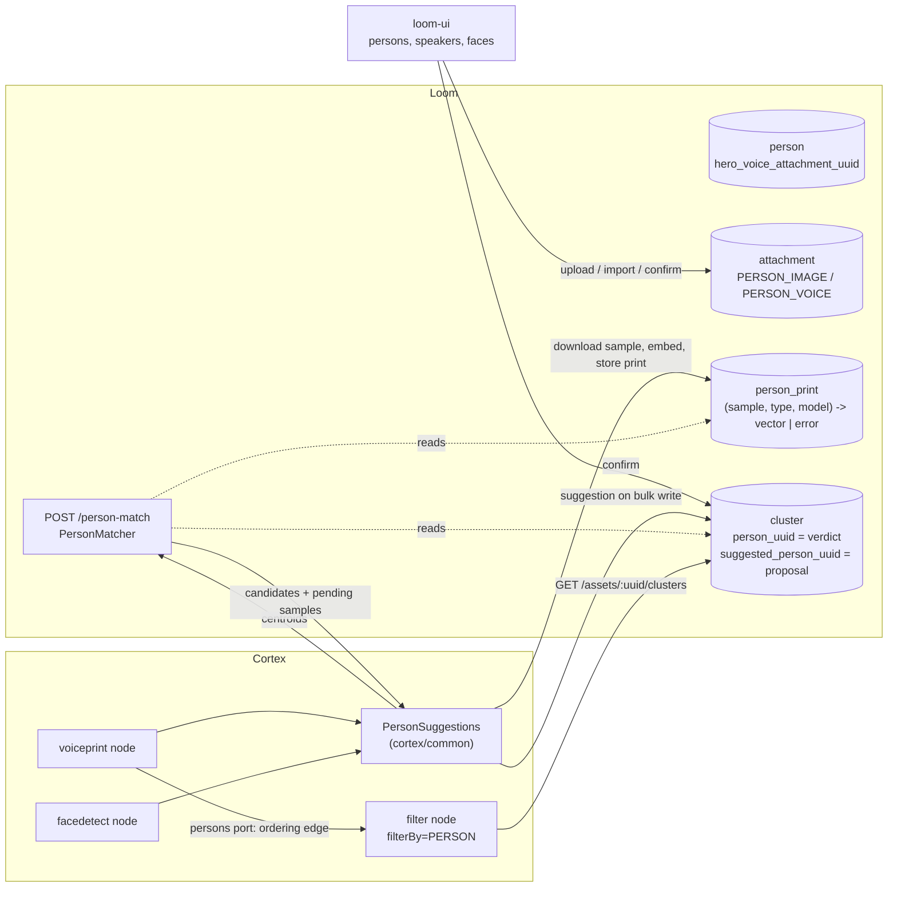

# Workflow: Person Recognition — voices and faces, suggested and confirmed

> **Status**: BUILT (2026-10-11). A person owns voice samples beside their pictures; the `voiceprint`
> and `facedetect` nodes match every cluster they find against the persons whose voices and faces are
> known and store the closest one as a **suggestion**; a reviewer confirms or rejects; the `filter`
> node routes on who is in an item (`filterBy=PERSON`).
> **Scope**: the cross-asset half of identity that [WORKFLOW_FACE.md](WORKFLOW_FACE.md) §2.2 called
> phase 2 — for faces and voices alike — plus the person-owned voice data it needs.
> **Audience**: AI coding agents working on `loom/services/rest` (persons, clusters, matching),
> `cortex/common` (`PersonSuggestions`), `cortex/nodes/{voiceprint,facedetect,filter}` and
> `loom-ui/src/features/{faceDetection,persons}`.

Family index: [WORKFLOWS.md](WORKFLOWS.md). The per-asset half — detect, embed, cluster, confirm — is
[WORKFLOW_FACE.md](WORKFLOW_FACE.md) for faces and [NODE_VOICEPRINT.md](../features/nodes/voiceprint/NODE_VOICEPRINT.md)
for voices; this file starts where a cluster exists.

| Not here | There |
|---|---|
| Per-asset face detection, clustering and the confirm endpoint | [WORKFLOW_FACE.md](WORKFLOW_FACE.md) |
| The voiceprint node, its sidecar, model choice and thresholds | [NODE_VOICEPRINT.md](../features/nodes/voiceprint/NODE_VOICEPRINT.md), [VOICEPRINT_SIDECAR.md](../sidecars/VOICEPRINT_SIDECAR.md) |
| The filter node and its other strategies | [NODES.md](../features/nodes/NODES.md) §3.3, [NODE_DATA_TYPES.md](../features/nodes/NODE_DATA_TYPES.md) §4.5 |
| ANN search, the `VectorIndex` SPI | [SEMANTIC_SEARCH.md](../features/search/SEMANTIC_SEARCH.md) |
| Consent to publish a confirmed person | [WORKFLOW_RIGHTS_RELEASE.md](WORKFLOW_RIGHTS_RELEASE.md) |

---

## 0. Executive Summary

| Question | Answer |
|---|---|
| Can the same person be recognised in two recordings? | Yes. Each new cluster is compared with what is known about every person, and the closest person above a threshold is **suggested**. |
| What is "known about a person"? | (a) the centroid of every cluster a reviewer **confirmed** to be them, (b) a **print** of each of their own samples - voice samples for speaker clusters, pictures for face clusters. |
| Does anything get attributed automatically? | No. A suggestion is `cluster.suggested_person_uuid`; the verdict stays `cluster.person_uuid`, written only by a reviewer. Voiceprints and face vectors used to identify people are GDPR Art. 9 data; the voiceprint study recommends human confirmation of every name. |
| Where does matching run? | In Loom: `POST /api/v1/person-match`, brute force over the references of one `(type, model)` space. Cortex calls it with the cluster centroids. |
| Who embeds a person's uploaded sample? | The node that owns the model, lazily: the match response lists samples without a print in that model, the node embeds them with its own sidecar or detector, stores the print, and matches again. |
| How does a pipeline filter by person? | `filter` with `filterBy=PERSON`. Wire `voiceprint.persons` / `facedetect.persons` into the filter's `persons` input so it runs after them. Default evidence is CONFIRMED. |

---

## 1. Architecture



### 1.1 The cycle, step by step

1. **A person gets samples.** Voice: `POST /persons/:uuid/voice-samples` (upload, audio or video) or
   `.../voice-samples/from-cluster` (Loom cuts the speaker's longest turn, at most 30 s, with ffmpeg
   into 16 kHz mono WAV). Faces: the existing picture gallery (`/persons/:uuid/images`) - nothing new.
2. **A node runs over an item** and finds clusters. Before writing them it calls
   `PersonSuggestions.suggest(...)` with every centroid.
3. **Loom matches.** `PersonMatchEndpointService` reads the confirmed centroids
   (`ClusterDao.listConfirmedReferences`) and the usable prints (`PersonPrintDao.listUsableReferences`) of
   the requested `(type, model)`, pools them per person (normalised mean), scores each probe by cosine,
   and returns at most `limit` candidates above `threshold`. It also lists up to `pendingLimit` samples
   of the matching attachment type that have no print in that model.
4. **The node enrols pending samples**: download, embed with its own model, `POST .../prints` with the
   vector - or with an `error` ("no speech found", "no face found", "not decodable ...") so the sample
   is not retried. Transient failures (sidecar down, ffmpeg missing) record nothing. If anything was
   enrolled, the node matches once more.
5. **The node writes its clusters** with `suggestedPersonUuid` / `suggestedScore`; Loom drops a
   suggestion naming a person deleted in the meantime. The node emits `persons` (struct/persons).
6. **A reviewer decides** in the UI: confirm the suggestion with one click, pick another person,
   create one, or reject. A confirmed cluster becomes a reference for every later match.
7. **The filter routes** on `GET /assets/:uuid/clusters`: per cluster the confirmed person, or -
   with `personEvidence=SUGGESTED` - the suggestion.

---

## 2. Schema (V2.114, V2.115)

| Object | Change | Why |
|---|---|---|
| `attachment_type` | `PERSON_VOICE` (V2.114, enum-only migration) | A person's voice sample; same lifetime as `PERSON_IMAGE`: owned by the person, never by an asset. |
| `person.hero_voice_attachment_uuid` | FK attachment, `ON DELETE SET NULL` | The voice counterpart of the avatar. |
| `cluster.suggested_person_uuid`, `cluster.suggested_score` | FK person `SET NULL`; real | The producer's proposal. **Not** in `ClusterDaoImpl.REVIEW_COLUMNS`, so an upsert restates it every run - unlike `person_uuid`. |
| `person_print` | new table, unique `(attachment_uuid, type, model)`, CHECK vector xor error | A sample's vector in one model. Both FKs cascade. `type` is the **cluster** type it compares with (`speaker`, `face`). |
| `idx_cluster_type_model_person` | partial index `WHERE person_uuid IS NOT NULL` | The reference read behind every match. |
| `StorageCategory.PERSON_VOICE` | storage report bucket | Voice samples are small but biometric; an operator should see them. |

Confirmed clusters are **not** copied into `person_print`: they already carry a centroid. A suggestion
never becomes a reference - only `CONFIRMED` clusters are read - so one wrong match cannot reinforce
itself across a library.

---

## 3. REST

| Route | Permission | Notes |
|---|---|---|
| `GET /persons/:uuid/voice-samples` | READ_PERSON | Each sample with its `prints` (model, usable, error - never the vector). |
| `POST /persons/:uuid/voice-samples` | UPDATE_PERSON | Multipart `file`, optional `poolUuid`. Only `audio/*` or `video/*` (415 otherwise). Duration probed with ffprobe when media derivation is on. |
| `POST /persons/:uuid/voice-samples/from-cluster` | UPDATE_PERSON + READ_CLUSTER + READ_ASSET_BINARY | `{clusterUuid, timeFrom?, timeTo?}`; both times or neither; at most 120 s; speaker clusters only. Provenance in `meta.source`. 503 without ffmpeg, 501 for object-store assets. |
| `GET /persons/:uuid/voice-samples/:sampleUuid/data` | READ_PERSON | |
| `DELETE /persons/:uuid/voice-samples/:sampleUuid` | UPDATE_PERSON | Prints cascade; hero pointer nulls. |
| `POST /persons/:uuid/voice-samples/:sampleUuid/prints` | UPDATE_PERSON | Node-written. `type` must be `speaker`. |
| `POST /persons/:uuid/images/:imageUuid/prints` | UPDATE_PERSON | Node-written. `type` must be `face`. |
| `POST /persons/:uuid/hero-voice` | UPDATE_PERSON | `{sampleUuid}`; blank clears. |
| `POST /person-match` | READ_PERSON | RPC (singular path; `POST /persons/match` would collide with `POST /persons/:uuid`). |
| `GET /assets/:uuid/audio-clip?from=&to=` | READ_ASSET_BINARY | 16 kHz mono WAV, at most 120 s, cut per request; 422 when the range holds no audio. |

`ClusterResponse` now carries `personName`, `suggestedPersonUuid`, `suggestedPersonName`,
`suggestedScore` and `model`; names are resolved with one `PersonDao.loadDisplayNames` query per
response page. `ClusterMemberModel` carries `timeFrom` / `timeTo`. `PersonResponse` carries
`heroVoiceUrl`. An address that pairs a sample with the wrong person answers 404, not 403.

---

## 4. Cortex

| Node | Change |
|---|---|
| `voiceprint` | Options `suggestPersons` (default true) and `suggestThreshold` (0 = per-model default: ReDimNet2 0.43, WeSpeaker 0.46, SpeechBrain 0.48, else 0.5 - the FAR 1 % points on VP-DE in `voiceprint-eval/results/transfer.csv`). Enrols a voice sample by demuxing it to WAV and taking the sidecar's pooled vector. New `persons` output. |
| `facedetect` | Same two options (default threshold 0.45, stricter than InspireFace's LFW 0.24-0.27). Enrols a picture with its **largest** face. Only matches when `embeddingsEnabled`. New `persons` output. `facedescription` hides both options. |
| `filter` | `filterBy=PERSON`, options `personSource` (ANY / FACE / VOICE) and `personEvidence` (CONFIRMED / SUGGESTED), optional MANY input `persons` (struct/persons) used only to order the filter after the producers. Never cached. |

Hint grammar for `PERSON`: a name (alias, else "first last", case-insensitive, whitespace
collapsed), a person uuid, `*` (anybody known), `nobody`, `!x` veto. At least one positive hint must
match and no veto; a bucket of only vetoes matches when none is present. Empty `match` falls back to
the bucket id. Asset unknown or clusters unreadable -> `other`, never `nobody`.

The `persons` payload (`PersonSuggestions.personsPayload`):

```json
[ { "personUuid": "...", "name": "Anna Meyer", "source": "voice", "status": "CONFIRMED",
    "clusterUuid": "...", "clusterIndex": 0 },
  { "personUuid": "...", "name": "Bert Huber", "source": "voice", "status": "SUGGESTED",
    "score": 0.61, "clusterUuid": "...", "clusterIndex": 1 } ]
```

On a worker-cache hit both producers re-read their clusters from Loom for this port, because a
reviewer may have confirmed one since the first run.

---

## 5. UI

- Face review (`FaceDetectionManagement`) lists `type=face` clusters only - speaker clusters used to
  appear there as crop-less cards - and shows a suggestion chip with one-click confirm.
- A Speakers review tab beside it: per speaker cluster the speaking time, turns, a player for the
  longest turn (via `audio-clip`), suggestion confirm, assign, create, reject, detach, and "save as
  voice sample".
- Person detail: voice samples with player, source, enrolled models, hero, delete, upload, import from
  the person's confirmed speaker clusters, and a warning below 30 s of reference speech.
- Media elements cannot send an `Authorization` header: every audio element plays an object URL from
  an authenticated fetch.

---

## 6. Conventions and Gotchas

- **Suggestion vs verdict.** Never write `person_uuid` from a producer, and never read
  `suggested_person_uuid` where a statement of identity is needed (exports, tags, the default filter).
- **One space per `(type, model)`.** A print in model A is invisible to a match in model B. Switching
  a node's model re-enrols every sample on its next runs - which is why samples are stored as audio and
  pictures, not as vectors.
- **Unusable vs transient.** `UnusableSampleException` is recorded as a print error and the sample is
  not retried in that model; any other exception records nothing. Do not "simplify" by recording
  every failure: a sidecar outage would permanently disable every pending sample.
- **The `persons` edge carries ordering, not data.** The filter reads Loom because Loom also has
  earlier confirmations and the other producer's clusters.
- **`MAX_ENROLMENTS_PER_ITEM = 10`.** A backlog drains over the first items rather than stalling one.
- **Brute force is deliberate.** Hundreds to a few thousand persons with a handful of references each;
  the `VectorIndex` is the path when that stops being true.
- **A filter verdict on persons is never cached** (`FilterStrategy.cacheable()` false); everything else
  still is.
- **`AudioClipService` writes bit-exact WAV** (`-map_metadata -1 -fflags +bitexact`): an empty cut is
  then exactly the 44-byte header, which is how a range past the end is told apart from a short one.

---

## 7. Test Setup

| Layer | Tests | Needs |
|---|---|---|
| DAO | `PersonPrintDaoTest`, `PersonDaoTest` (voice gallery, hero SET NULL, cascade, display names), `ClusterDaoTest` (suggestion restated, verdict kept, references, member time window) | `./setup-pool.sh` after the migrations |
| REST | `PersonVoiceEndpointTest` (12, incl. permissions), `PersonMatcherTest` (unit) | ffmpeg for the cut tests (skipped without) |
| Cortex | `PersonFilterNodeTest` (12), `VoiceprintPersonSuggestionTest` (8), `FacedetectPersonSuggestionTest` (4) | ffmpeg for voice enrolment |
| E2E | `PersonRecognitionIntegrationTest`: stubbed sidecar (always) and live sidecar (skipped without `:9150`) - a voice cut from one recording recognised, alone, in another | `sidecars/voiceprint/container.sh run` for the live half |
| Clients | `clients/python/test.sh` parity | - |
| UI | `src/features/speakers/speakerTurns.test.ts`, `src/api/media.test.ts` (vitest); `e2e/speaker-review-mocked.spec.ts` (10), `e2e/person-voice-mocked.spec.ts` (9) | `./node_modules/.bin/...`, never `npx` |

`JooqTestContext.afterEach` now closes the per-test c3p0 pool; before, a DAO test class with more than
about 20 methods ran out of PostgreSQL connections.

---

## 8. Key Classes Reference

| Class | Package / module | Purpose |
|---|---|---|
| `PersonPrintDao`, `PersonPrint`, `PersonReference` | `loom/db/api` `...db.model.person` | Prints and the reference record matching reads |
| `PersonPrintDaoImpl` | `loom/db/jooq` | Upsert, usable references, unenrolled queue |
| `ClusterDao.listConfirmedReferences` | `loom/db/api` | Confirmed centroids of one space |
| `PersonMatcher` | `loom/services/rest` `...rest.service.person` | Pooling and scoring, pure |
| `PersonMatchEndpoint(Service)` | `loom/services/rest` | `POST /person-match` |
| `PersonEndpointService` | `loom/services/rest` | Voice samples, prints, hero voice, `longestTurn` |
| `AudioClipService` | `loom/services/rest` | ffmpeg cut and ffprobe duration |
| `PersonSuggestions` | `cortex/common` `...common.person` | Match, enrol, persons payload |
| `PersonFilterStrategy`, `PersonMention`, `PersonSource`, `PersonEvidence` | `cortex/nodes/filter/core` | `filterBy=PERSON` |

---

## 9. Where do I find ...?

| What | Where |
|---|---|
| Migrations | `loom/db/flyway/.../V2.114__attachment_type_person_voice.sql`, `V2.115__person_voice_and_recognition.sql` |
| Voice thresholds and their source | `VoiceprintNodeOptions.resolvedSuggestThreshold` |
| Face threshold | `FacedetectNodeOptions.DEFAULT_SUGGEST_THRESHOLD` |
| Demo voices | `demo-content/voices/`, seeded by `DemoDatabaseInitializer.createPersonVoice`; demo pipeline "Who Is Speaking" (`speakerRoutingDefinition`) |
| Customer docs | `website/content/english/docs/nodes/filter/`, `.../nodes/voiceprint/`, `.../nodes/facedetect/`, `.../ui/` (persons) |

---

## 10. Progress Assessment

- [x] Schema: voice samples, hero voice, suggestion columns, `person_print` (V2.114/V2.115), jOOQ regen
- [x] DAO + tests incl. delete cascades
- [x] REST: samples, import from a speaker, prints, hero voice, matching, audio clips; endpoint + permission tests
- [x] Java and Python clients (Python parity green)
- [x] `PersonSuggestions` shared by `voiceprint` and `facedetect`; lazy enrolment of voice samples and pictures
- [x] `filterBy=PERSON`, `struct/persons` content type, filter `persons` input
- [x] Descriptors, OpenAPI and website copies regenerated
- [x] Integration test incl. a live recognition across two recordings
- [x] Demo: two synthetic voices, demo pipeline "Who Is Speaking"
- [x] UI: speakers review, suggestions, person voice section
- [x] Customer docs
- [ ] AS-norm with an in-domain cohort and per-source threshold calibration (the study's recommendation) - thresholds are the study's VP-DE FAR-1 % points
- [ ] Library-wide clusters (`cluster.asset_uuid IS NULL`) that group unknown people across assets - this cycle only recognises people who are already in the directory
- [ ] Matching through the `VectorIndex` once the directory outgrows brute force
- [ ] Bulk "confirm all suggestions above X" in the review UI - deliberately not built yet

---

_Git HEAD revision: `6718998a`_
_Last updated: 2026-10-11 (created with the feature)_
