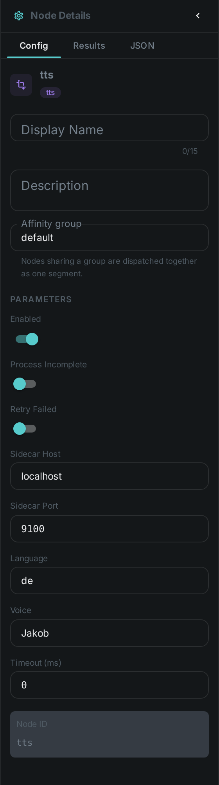
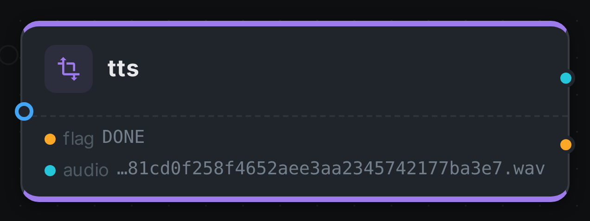

The TTS node **generates narration audio from text**. Unlike the analysis nodes, which describe a
property of the media itself, TTS has a single `text` input port that accepts any text type — connect
an link:../llm/[LLM] summary, a link:../captioning/[caption], or a translated
link:../whisper/[transcript] to it — and synthesizes speech, attaching the audio to the asset.

German is synthesized with one of two voices — **Kartoffelbox**, the clearer of the two, or
**Orpheus-3B / Kartoffel** — and English with **Kokoro**. All of them run behind a small HTTP
sidecar, so the node stays a pure client and needs no model runtime of its own. Which German voice
answers is chosen where the sidecar runs, not per pipeline, because only one of them can be held in
memory at a time.

++++

++++

[cols="1,3"]
|===
| Kind | `tts`
| Applies to | Any asset (the audio is generated from upstream text, not from the media)
| Input ports | `text` — accepts any text type, so an LLM answer, a caption or a transcript can be wired straight into it
| Output ports | `audio` (the generated WAV, ready for link:../s3-sink/[S3 Sink]), `flag` (String)
| Requirements | A running **TTS sidecar**. German needs a GPU for either voice; English runs on the CPU.
| Persists to | `asset_node_result` ledger only — the generated WAV stays in the worker's local `tts_bin` cache (as with thumbnails)
|===

== Configuration

.The node's settings in the pipeline editor

Set these in the panel above, or in the node's `options` block in a pipeline definition:

[options="header",cols="1,2"]
|===
| Option | Meaning
| `ttsHost` / `ttsPort` | Address of the TTS sidecar (default `localhost:9100`)
| `language` | Which voice set speaks: `de` or `en` (default `de`). Regional tags such as `de-AT` work too.
| `voice` | Voice name for that language (default `Jakob`; English e.g. `af_heart`). Ask the sidecar for the list it actually offers — it reports the voices the running configuration has, which for German depends on the voice set installed there.
|===

Nothing configures where the words come from — connect a port to `text` and the node speaks whatever
arrives on it.

== Long text, and how it sounds

**A long text is spoken in full.** Every speech model can only generate so much audio in one pass —
around forty to fifty seconds — and beyond that it used to stop wherever it happened to be, leaving
a file that looked complete and ended mid-word. The sidecar now splits a longer text at sentence
boundaries (falling back to clause and word boundaries inside a very long sentence), speaks each
part, and joins them with the kind of pause a speaker would make. Nothing is dropped or reordered.

The audio is also finished before it is handed back: the dead air each model leaves around its
speech is trimmed, so a join sounds like a breath rather than a hole, and the level is kept inside
full scale, so loud syllables no longer crackle. A deployment can additionally ask for a
"radio/podcast" sound — a fixed delivery loudness with light equalisation and compression — which is
off by default.

== Seeing it run

Turn on link:../../pipeline/#debug-mode[Debug Mode] and every node keeps what it produced, on the
card itself. Below is a real run at the shipped `language: de` / `voice: Jakob`, speaking the German
transcript that link:../translate/[Translate] and link:../sentiment/[Sentiment] also work on.

`audio` carries the path of the WAV in the worker's local cache and `flag` records how the node
finished. The audio itself is not uploaded anywhere yet — the bytes live beside the worker, exactly
as link:../thumbnail/[Thumbnail] leaves its contact sheet.

== Use Cases

* **Audio descriptions** — speak an link:../llm/[LLM]-generated description or
  link:../captioning/[caption] for accessibility.
* **Dubbing / narration** — voice a translated link:../whisper/[transcript] back onto the asset.
* **Bilingual output** — German and English, chosen per pipeline.
* **Narrated articles** — speak a whole page of text; it is no longer cut short.

The sidecar is a small HTTP service that ships with Metaloom, with a setup script and a run script
of its own. It can also hand the heavy German language model to a separate inference server, which
is the usual production arrangement.
