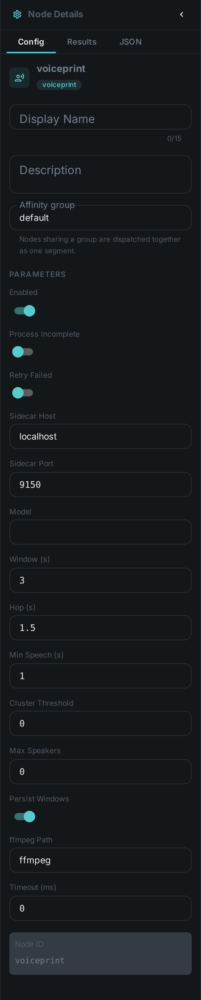
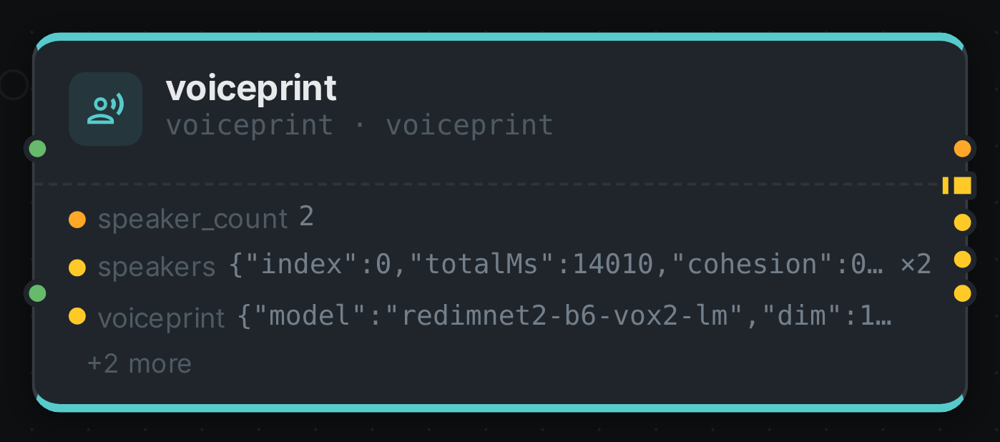

The voiceprint node **finds the distinct voices** in an audio file or a video's soundtrack, tells you
**when each voice speaks**, and computes a **voiceprint** for every voice: a speaker embedding, a
short list of numbers that is close for recordings of the same person and far apart for different
people. It is the audio counterpart of link:../facedetect/[Face Detection]. Where that node groups
the faces in a video into the people it shows, this one groups the speech into the people you hear.

The voices are stored as **speaker clusters**, the same kind of record face clusters are. Every
review and naming step you already use for faces therefore works on voices: confirm a speaker,
attach them to a person, and that person's voiceprint is on file for the next recording.

++++

++++

[cols="1,3"]
|===
| Kind | `voiceprint`
| Applies to | Video, Audio
| Input ports | `audio` or `video` — exactly one of the two is wired
| Output ports | `speaker_count` (Number), `speakers` (**one element per voice**), `voiceprint`, `timeline`, `result`
| Requirements | A running **voiceprint sidecar**. It runs on a CPU; a GPU makes it many times faster. For video, `ffmpeg` on the worker, which extracts the soundtrack so the pictures are never uploaded.
| Persists to | One voiceprint per few seconds of speech, one speaker cluster per voice, a timeline component, and the processing ledger
|===

== How it works

1. **Find the speech.** Silence and pauses are skipped, so a long recording with little talking is
   cheap to process.
2. **Cut it into windows.** Each stretch of speech is cut into overlapping windows of three seconds,
   and each window gets its own voiceprint. A window is long enough to identify a voice and short
   enough that it rarely holds two people.
3. **Group the windows into speakers.** Windows whose voiceprints are close enough belong to the
   same voice. The threshold that decides "close enough" is calibrated per model, so the default
   works whichever model you pick.
4. **Build the timeline.** Each speaker gets their turns, their total speaking time and one
   voiceprint summarising them. Speakers are numbered by how long they talk, so speaker 1 is the main
   voice of the recording.

== Choosing the model

The model runs in a small service next to the worker, the **voiceprint sidecar**. It offers three
models behind the same interface, and you pick one with the node's `model` setting. Nothing else in
your pipeline changes.

[options="header",cols="2,3,2,2"]
|===
| `model` | What it is | Licence | When to choose it
| `redimnet2` (default) | ReDimNet2-B6, trained on VoxCeleb2 | MIT | The most accurate model whose licence permits commercial use. The right default.
| `wespeaker` | WeSpeaker ResNet34, the voiceprint model inside pyannote | CC-BY-4.0, attribution required | Fastest, smallest. Choose it for very large archives on CPU.
| `speechbrain` | SpeechBrain ECAPA-TDNN | Apache-2.0 | A widely used baseline without an attribution requirement.
|===

The default was chosen by measurement. Twenty-two speaker-recognition approaches were compared on
Austrian and German speakers: European Parliament speeches recorded years apart, volunteer
recordings, and the same audio degraded to telephone quality, with background babble, reverberation
and low-bitrate MP3. ReDimNet2 was the most accurate of the models that may be used commercially. It
is also small enough to run on a CPU.

[NOTE]
====
Voiceprints from different models are **not comparable**. Each one is stored with the model that made
it, so switching models adds a new set of voiceprints next to the old ones instead of mixing them.
Re-run the node over your archive after switching if you want everything in the new space.
====

== What it produces

The `result` port and the stored timeline component look like this. Times are milliseconds from the
start of the media.

[source,json]
----
{
  "model": "redimnet2-b6-vox2-lm",
  "speakerCount": 2,
  "durationMs": 37530,
  "speechMs": 30290,
  "threshold": 0.4,
  "speakers": [
    { "index": 0, "totalMs": 14010, "cohesion": 0.88, "windowCount": 7,
      "segments": [ { "startMs": 2420, "endMs": 7440 }, { "startMs": 15470, "endMs": 19950 } ] },
    { "index": 1, "totalMs": 12020, "cohesion": 0.90, "windowCount": 6,
      "segments": [ { "startMs": 8660, "endMs": 14220 }, { "startMs": 22430, "endMs": 29250 } ] }
  ],
  "windows": [ { "index": 0, "startMs": 2420, "endMs": 5420, "speaker": 0 } ]
}
----

`cohesion` says how alike a speaker's windows are, from 0 to 1. A low value usually means two similar
voices were merged into one speaker. Lowering `maxSpeakers` or raising `clusterThreshold` separates
them.

The voiceprints themselves are not in this document. They are stored as embeddings, one per window,
each carrying the time range it covers, so a search can answer "where else does this voice appear"
down to the second.

== Configuration

.The node's settings in the pipeline editor

Set these in the panel above, or in the node's `options` block in a pipeline definition:

[options="header",cols="1,2"]
|===
| Option | Meaning
| `voiceprintHost` / `voiceprintPort` | Address of the voiceprint sidecar (default `localhost:9150`)
| `model` | `redimnet2`, `wespeaker` or `speechbrain`. Empty uses the sidecar's default, ReDimNet2
| `windowSeconds` / `hopSeconds` | Length of the window one voiceprint covers, and the step between windows (default 3 s / 1.5 s)
| `minSpeechSeconds` | The shortest stretch of speech that still gets a voiceprint (default 1 s)
| `clusterThreshold` | How similar two windows must be to count as the same voice, from -1 to 1. `0` uses the chosen model's calibrated default
| `maxSpeakers` | An upper bound on the number of voices, when you know it. `0` means no bound
| `persistWindows` | Store a voiceprint for every window (default), or only one per speaker
| `ffmpegPath` | The `ffmpeg` used to extract a video's soundtrack
| `timeoutMs` | Time budget per item. `0` allows ten minutes
|===

== Seeing it run

Turn on link:../../pipeline/#debug-mode[Debug Mode] and every node keeps what it produced, on the
card itself. Below is a real run at the default settings over a 37-second recording of two voices
taking five turns.

The strip lists what each output port carried. `speaker_count` is 2, and `speakers` holds two
elements, one per voice, each with its turns and its voiceprint. `voiceprint` is the single vector
over all the speech, named with the model that made it. Every three-second window of this recording
was attributed to the voice that was really speaking in it.

== Use Cases

* **Who said what** — run it next to link:../whisper/[Speech-to-Text] and line the transcript up
  with the speaker turns.
* **Find a person across the archive** — confirm a speaker once, and their voiceprint finds them in
  every other interview, press conference and phone-in.
* **Count and time the voices** — speaking time per person for panels, debates and interviews.
* **Route by speaker count** — the `speaker_count` port feeds a link:../filter/[Filter], for example
  to send monologues and conversations down different branches.

== Before you identify people

A voiceprint that is used to recognise a person is **biometric data** under the GDPR. Decide on the
legal basis before you name speakers. In Austria, § 9 DSG covers journalistic use by media companies.
Recognising people in archive audio may also be a high-risk use under the EU AI Act. This page is not
legal advice.

Treat every match as a **suggestion**. Recordings made years apart, over the telephone or in a noisy
room are measurably harder, and a person should confirm a name before it is published.

== Model attribution

`redimnet2` is MIT-licensed and `speechbrain` is Apache-2.0. The `wespeaker` model is CC-BY-4.0,
which requires attribution to the WeSpeaker project wherever its results are shown. The model used is
recorded with every voiceprint. All three models were trained on VoxCeleb, a dataset of YouTube
interviews. See link:../../legal/model-licenses/[Model Licenses] for what that means for a commercial
deployment.
